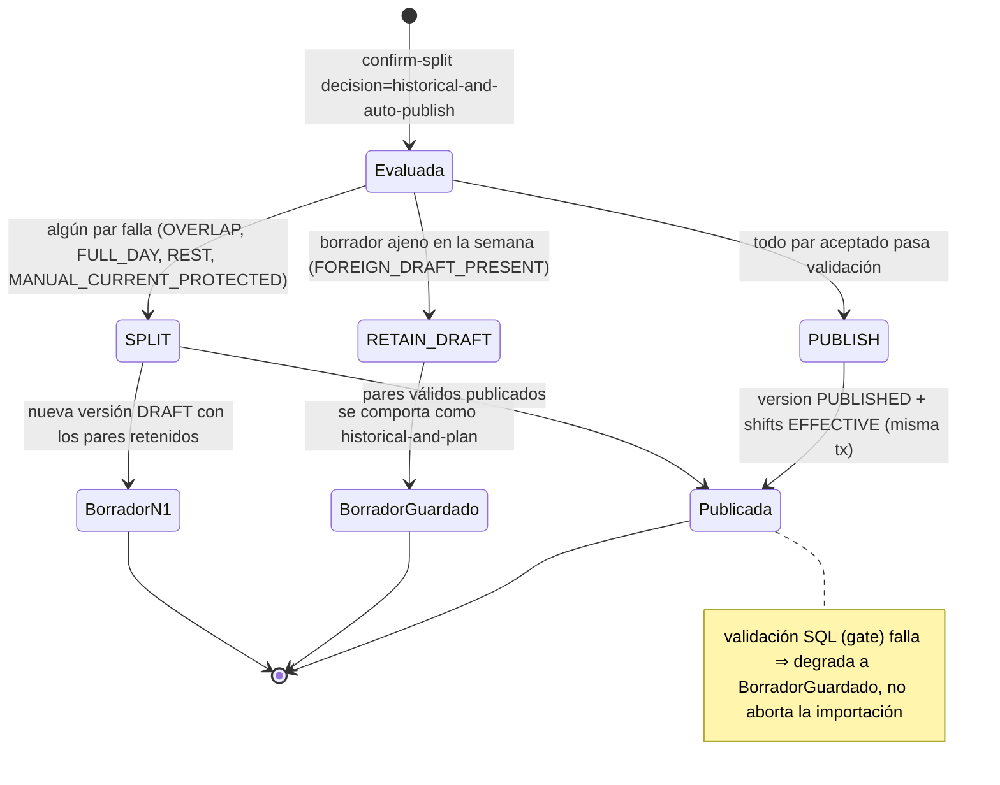
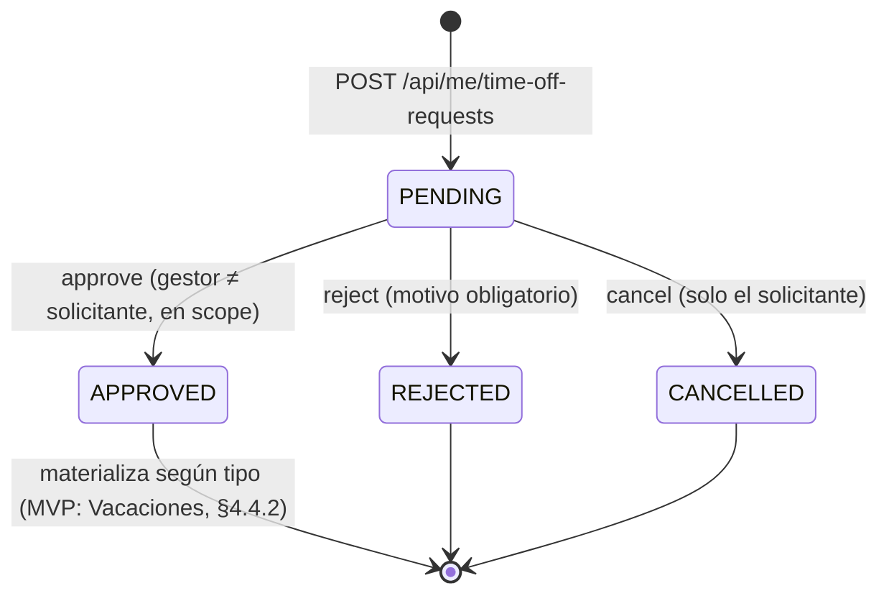
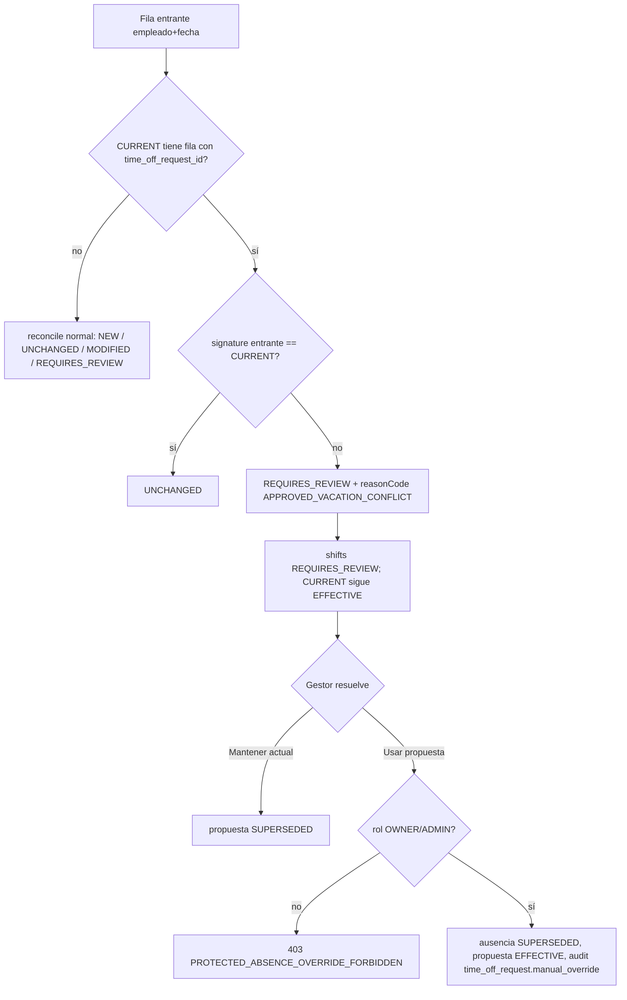

# SPEC — ShiftImport · Simplificación de planificación, auto-publicación, mobile-first y vacaciones

**Estado**: CANÓNICA — decisiones de producto cerradas el 2026-10-30 (§1.4, §9.1). Lista para revisión de implementación. Nada de lo descrito aquí está implementado.
**Fecha**: 2026-10-30 · `VERIFIED_AGAINST=d580b252e77f54b3a9df4342e61157f9098d5914` (`development`; HEAD local = `origin/development`, comprobado con `git fetch` el 2026-10-30)
**Modo de este documento**: documentación. No modifica código, base de datos ni Git.
**Supersedes**: `docs/specs/P5.7-MASTER-SPEC.md` y `docs/specs/SPEC-SHIFTIMPORT-POST-UX-AUDIT-CRC-TRYP-END-TO-END.md` (absorbidas; ver Apéndice A). Git conserva su historial.
**Fuentes integradas**: auditoría funcional/UX/vacaciones y prompt maestro; Manual Trip (PDF + PPTX); capturas Samsung; las dos specs anteriores.

---

## 0. Document Authority

```text
THIS_DOCUMENT_IS_THE_SINGLE_IMPLEMENTATION_SPEC_FOR_THIS_PROGRAM=true
ONE_SPEC=true  ONE_ROADMAP=§7  ONE_SET_OF_GATES=§20  ONE_DECISION_REGISTER=§1.4+§9.1
```

### 0.A Jerarquía

```text
AOS Governance
↓
Contratos transversales canónicos (Design System, MODAL / LOCALIZATION / UI_MOTION, marca, seguridad de agentes, Git/promoción)
↓
Contratos de producto canónicos de ShiftImport (docs/product/*, docs/standards/*, .anclora/*)
↓
ESTA SPEC
↓
Implementación
```

Esta spec **no puede contradecir** niveles superiores. Si necesita cambiar un contrato de producto: lo declara (§0.3), da la redacción objetivo, lo incluye como F0 y el contrato se actualiza **antes** de escribir código. Los contratos transversales y de producto siguen siendo fuentes normativas independientes: esta spec los **referencia** (`REFERENCE_EXISTING`) y solo dice cómo se aplican aquí; no los copia.

### 0.B Contratos referenciados (no duplicados)

| Contrato | Ubicación | Cómo se aplica en esta iniciativa | Acción |
|---|---|---|---|
| Governance AOS (documentación, seguridad de agentes, operación, QA proporcional) | `anclora-governance/standards/` (`DOCUMENTATION_GOVERNANCE_STANDARD`, `AGENT_SECURITY_STANDARD`, `AGENT_OPERATING_STANDARD`) | §16 (QA), §18 (Git), §13 (seguridad). Esta consolidación es `MERGE`; la fuente absorbida se elimina por instrucción expresa de Toni y Git conserva su historia (la trazabilidad `supersedes` está en la cabecera) | REFERENCE |
| Design System | `anclora-design-system` + `docs/design-system-wave3-pilot3.md` | §10 | REFERENCE |
| `MODAL_CONTRACT` | `docs/standards/MODAL_CONTRACT.md` (copia; canónico en la vault) | §10.2 | REFERENCE |
| `LOCALIZATION_CONTRACT` | `docs/standards/LOCALIZATION_CONTRACT.md` | §6, §10.4 | REFERENCE |
| `UI_MOTION_CONTRACT` | `docs/standards/UI_MOTION_CONTRACT.md` | §10.3 | REFERENCE |
| Contratos de marca y `ANCLORA_PREMIUM_APP_CONTRACT` | `docs/standards/` | No se toca marca; Trip no aporta marca (§5.5) | REFERENCE |
| Contratos de producto no modificados | `docs/product/`: `IMPORT_OUTCOME_CONTRACT`, `EMPLOYEE_SELF_SERVICE_CONTRACT`, `TEMPORAL_ORGANIZATIONAL_MODEL`, `APPLICATION_STRUCTURE_AREAS_OPTIONAL`, `EMPLOYEE_SHIFT_SWAP_DEFERRED`, `PLAN_AWARE_ORGANIZATION_ONBOARDING_CONTRACT`, `NEON_MAIN_MIGRATION_RECONCILIATION` | Vigentes; esta spec no los cambia | REFERENCE |
| Contratos de producto enmendados | Los siete de §0.3 | Enmienda en F0-M02 | UPDATE (6) / CREATE (1) |
| Decisiones de producto previas | `sdd/decisions/PD-2026-09-06-D03/D04/D05`, `…P5.5…` | Registradas allí; resumidas en Apéndice C | REFERENCE |
| Adopción AOS y runtime | `.anclora/AOS_ADOPTION.md`, `.anclora/PRODUCTION_RUNTIME.md`, `AGENTS.md` | Excepción `EX-SI-001` (rama por defecto `development`) intacta | REFERENCE |

### 0.C Resolución de conflictos entre fuentes

```text
latest approved decision wins
+ repo evidence wins over stale documentation
+ canonical contract wins over local obsolete prose
```

Aplicado en el Apéndice A. Ejemplo: la spec post-UX recogía un addendum del 2026-10-15 que permitía publicar en la importación (`0ea63e5`); la evidencia del repo es que `307751a` (2026-10-16, seis horas después) lo supersedió («importar crea o actualiza la planificación; nunca publica») y `FUTURE_IMPORT_DRAFT_CONTRACT.md:22` lo confirma. Gana el repo hasta que OD-01 (2026-10-30) lo enmiende en F0 con la regla condicionada de §0.3. Investigación completa en §9.4 (R-14).

### 0.D Alcance documental de esta spec

Cubre, en un único documento: invariantes, dominio, base de datos y migraciones, contratos API, UX/CSS, i18n, Design System, accesibilidad, responsive, seguridad, QA, feature flags, reversión, auditoría, Git/despliegue, roadmap por microtareas, gates y registro de decisiones. No existen ni se crearán specs, addenda ni roadmaps paralelos para esta iniciativa.

---

### 0.0 Verificación de la auditoría contra el repositorio

La auditoría se contrastó línea a línea con `d580b25`. Esta spec **corrige** la auditoría donde el código no coincide. Lo que no pude verificar se declara como tal.

### 0.1 Hallazgos

| # | Afirmación de la auditoría | Veredicto | Evidencia (archivo:línea) | Consecuencia en esta spec |
|---|---|---|---|---|
| V-01 | `confirmFutureImport` crea solo borradores | **Confirmado** | `api/_lib/future-import.js:352,811-818` (`autoPublish:false`, `publishedWeekCount:0`) | §3, §4.1 |
| V-02 | Default `historical-only` en ficheros `MIXED` | **Parcial** | `src/lib/calendar-import.js:63-72`: `FUTURE` ya defaultea a `historical-and-plan`; solo `MIXED` defaultea a `historical-only`. Los modales inicializan siempre `'historical-only'` (`ImportModal.tsx:379,641`; `TeamImportModal.tsx:196,735`). Las líneas 480/518 citadas **no coinciden** | §5.2 corrige el estado inicial de los modales, no solo el default |
| V-03 | Existen `findAssignmentConflict` y `checkMinimumRest` | **Parcial** | `findAssignmentConflict` existe (importada en `scheduling.js:5`). `checkMinimumRest` **no existe**; el equivalente es `calculateRestGapMinutes` (`scheduling.js:144`) y `assertMinimumRest` (`:243`), `MINIMUM_REST_HOURS = 11` (`:122`) | La spec usa los nombres reales |
| V-04 | La publicación puede ser granular | **Falso hoy** | `publishScheduleVersionTx` (`scheduling.js:831-988`) publica **toda la versión**, aborta entera ante un `OVERLAP`/`REST_RULE_VIOLATION`, solo supersede shifts de **versiones previas del mismo schedule** (`:929-945`) y **no** fija `provenance` ni `import_id` (`:947-973`) | Hay que escribir una función nueva, `publishImportedPairsTx` (§4.1.3). No basta "llamar a publicar" |
| V-05 | (omitido) | **Hueco de la auditoría** | `imports.import_decision` tiene `CHECK IN ('historical-only','historical-and-plan')` (`0042:13`) | La migración 0049 **debe** ampliarlo o el `INSERT` falla (§2.1) |
| V-06 | `/api/me/*` bloquea roles no-EMPLOYEE en `change-requests/index.js` | **Parcial** | Son **tres** archivos: `api/me/change-requests/index.js:16`, `…/[id]/cancel.js:23`, `…/shifts/[id]/change-requests.js:23` | §3.4 cubre los tres |
| V-07 | (omitido) | **Hueco de seguridad** | El SQL de aprobaciones autoriza a PLANNER **solo** con `memberships.scoped_area_id` (`approval-requests/index.js:111-117`, `[id]/approve.js:111-117`), ignorando `planner_scope_type` `AREAS`/`EMPLOYEES` (`0035`). Un PLANNER con scope `EMPLOYEES` tiene `scoped_area_id IS NULL` ⇒ la condición se cumple ⇒ ve y aprueba **toda** la organización. Leído en SQL; no ejercitado en runtime | Los endpoints nuevos usan `resolveEffectiveAccessScope`. El defecto existente se registra como D-01 y **no** se arregla en esta spec (§9) |
| V-08 | Los contratos permiten el flujo propuesto | **Falso** | `FUTURE_IMPORT_DRAFT_CONTRACT.md:22` ("La importación nunca publica"); `EFFECTIVE_CALENDAR_CONTRACT.md:20`; `SCHEDULING_DOMAIN.md:137-139`; `IMPORT_REVERSION_CONTRACT.md:54,56` | Enmienda obligatoria (§0.3) |
| V-09 | La reversión soporta versiones publicadas por la propia importación | **Falso hoy** | `planInverse` consulta un mapa `versions` **estático** (`import-reversion-planner.js:212-223`): una versión `PUBLISHED` bloquea con `PUBLISHED_DEPENDENCY` aunque la haya publicado la misma importación | §4.1.5 |
| V-10 | (omitido) | **Riesgo de pérdida de datos** | Borrar un `shift` auto-publicado en una reversión hace `ON DELETE CASCADE` sobre `change_requests` (`0024:21-23`) y, probablemente, acuses/comentarios (`0022`, `0023`; FK no inspeccionada) | Bloqueador nuevo `PUBLISHED_SHIFT_HAS_DEPENDENTS` (§4.1.5) |
| V-11 | Contrato de navegación: PLANNER no aprueba | **Obsoleto** | `OPERATIONAL_NAVIGATION_TIME_SCOPE_CONTRACT.md:29` vs. `approve.js:111` y `RBAC_SCOPE_MATRIX.md` (permiten) | Se corrige junto a V-08 |
| V-12 | `.weekly-planner__overflow-hint` roba ancho lateral | **Confirmado** | Es el primer hijo de `.weekly-planner__grid-region`, que es `display:flex` en fila (`index.css:4533-4539`; hint `display:flex` a ≤980 en `:4577`; JSX `WeeklyPlanner.tsx:674`) | §5.1.2 |
| V-13 | `.weekly-planner__day-focus` se aplasta; "es redundante" | **Causa confirmada; "redundante" falso** | `.weekly-planner__toolbar > div` (`index.css:3857`, especificidad 0,1,1) impone `flex-wrap:wrap`, que gana a `.weekly-planner__day-focus` (0,1,0). El item no tiene `flex-basis`, se estrecha a ~32px y sus botones se apilan en vertical. Además **no** es redundante: `activeDay` hace scroll a la cabecera del día (`WeeklyPlanner.tsx:209-215`) y deshabilita días pasados (`:585`) | **Desviación de la auditoría**: se rediseña, no se elimina (§5.1.1). Ver OD-02 |
| V-14 | El zoom-out se debe a `min-width` sin contención | **No verificado** | `.month-grid-shell` ya tiene `overflow-x:auto` (`index.css:2696-2703`), así que `min-width:760/780` (`:4922,:5026`) debería hacer scroll interno. El `<meta viewport>` es correcto (`index.html:6`). Que no se activen los breakpoints ≤560 en un móvil implica un layout viewport >560px, es decir, **algún elemento ensancha el documento**. No he identificado cuál | **F1-M00 es un diagnóstico obligatorio antes de cualquier fix de zoom-out** (§5.1.3). No se escribe CSS especulativo |
| V-15 | `getScheduleSnapshot` puede mostrar vacaciones | **Falso hoy** | `calendarShifts` filtra `origin='MAN' AND provenance IN ('MANUAL_ADMIN_CHANGE','MANUAL_CONFIRMED_WHOLE_DAY_OVERRIDE')` (`scheduling.js:489-491,504-506`) | §4.4.4 amplía el filtro |
| V-16 | `calendar_changes` admite un tipo de vacaciones | **Falso** | `change_type IN ('ADD_SHIFT','TIME_CHANGE','CANCEL_SHIFT','ADD_EXTRA','PARTIAL_ABSENCE','TYPE_CHANGE','REPLACE_DAY','RECONCILIATION')` (`0041`) | Se usa `REPLACE_DAY` + `source='EMPLOYEE_REQUEST'` |
| V-17 | Ledger registra la publicación | **Confirmado** | `0044:165` cubre `SCHEDULE_VERSION_UPDATE`; `shifts` cubre `INSERT`/`STATE_TRANSITION` | Sin triggers nuevos (§2.3) |
| V-18 | Siguiente migración libre | **Confirmado** | Última: `0048_versioned_worktime_targets.sql` | `0049` (F1) y `0050` (F2); ver §3 |
| V-19 | Análisis de Trip (CRC TRYP, Portal del Empleado, «Vacaciones por rondas») | **Verificado (PDF)** | Inspeccionadas visualmente las 8 páginas de `Manual Usuario Vs Tryp v3 5.pdf` (2026-10-30). Contrastado también el PPTX original (8 diapositivas, sin notas del orador): el texto coincide con el PDF; no añade contenido | Hallazgos en §5.5, separados en `OBSERVED_IN_TRIP` y `RECOMMENDED_FOR_SHIFTIMPORT`. Cambios derivados: §4.2 (`year`, `history`), §5.5, §9.2 |
| V-20 | Capturas Samsung | **Vistas (2 capturas, 2026-10-30)**; ver §5.1.0 | Solo dispongo del texto de la auditoría | El diagnóstico F1-M00 las sustituye por evidencia reproducible |

### 0.2 Restricciones de plataforma que condicionan el diseño

1. **Una sola base de datos para todas las ramas.** `development`, `staging`, `production` y `main` comparten la rama Neon `main` (`AGENTS.md:44,75`). Toda migración debe ser **aditiva y compatible con el código ya desplegado** en cualquier rama. Migrar sin código nuevo no puede romper nada; código nuevo sin migrar falla. Orden obligatorio: `db:migrate:status` → migración (con autorización) → despliegue.
2. **Las migraciones no gestionan transacciones.** `db/migrate.mjs` rechaza `BEGIN`/`COMMIT` tras el baseline (líneas 282-322). `0049` y `0050` no los llevan.
3. **Las transacciones de servidor son lotes estáticos.** `sql.transaction([...])` (Neon HTTP) no admite lógica condicional entre sentencias. La condicionalidad se expresa con CTE que filtran por el resultado de la sentencia anterior, como hace `publishScheduleVersionTx`. Toda la lógica "si falla la validación, queda en borrador" se implementa así.
4. **Visual QA**: `agent-browser` / `anclora-visual-qa`. Sin navegador disponible no es aceptable.

### 0.3 Enmiendas contractuales requeridas (F0)

| Documento | Cambio |
|---|---|
| `docs/product/FUTURE_IMPORT_DRAFT_CONTRACT.md` (§Future import) | "La importación nunca publica" → "no publica salvo decisión explícita `historical-and-auto-publish` (§4.1)". La decisión `historical-and-plan` conserva exactamente su semántica |
| `docs/product/EFFECTIVE_CALENDAR_CONTRACT.md` §1 | "Planning… Nunca se publican automáticamente" → idem. Añadir regla `APPROVED_VACATION_CONFLICT` a §4 |
| `docs/product/SCHEDULING_DOMAIN.md` (final) | Sustituir el párrafo "Importing the company plan" por la regla nueva. Documentar que una versión puede quedar publicada por una importación |
| `docs/product/IMPORT_REVERSION_CONTRACT.md` §4 | La fila "schedule version / assignments" admite revertir una versión `PUBLISHED` **si y solo si** la publicó la misma importación, no cambió desde entonces y no hay dependientes (§4.1.5) |
| `docs/product/OPERATIONAL_NAVIGATION_TIME_SCOPE_CONTRACT.md` | Corregir V-11; permitir TopBar compacto ≤640px (§5.1.4); `Aprobaciones` → `Solicitudes` |
| `docs/product/RBAC_SCOPE_MATRIX.md` | Añadir acciones de `time_off_requests` y la regla de override de ausencia protegida (§4.4) |
| `docs/product/` (nuevo) | `TIME_OFF_REQUEST_CONTRACT.md`: ciclo de vida, materialización, protección. Se escribe desde §3 y §4.4 |

**Redacción obligatoria de la enmienda (OD-01 aprobada)**: la regla nueva **no** es «toda importación publica». Es: «una importación puede publicar únicamente cuando (1) la ejecuta un rol con permiso efectivo de planificación sobre ese empleado/área, (2) el turno es válido, (3) la fecha es hoy o futura, (4) afecta solo a empleados y periodos presentes en la propia importación, (5) no existe conflicto bloqueante y (6) cualquier caso ambiguo queda en borrador/revisión». Ver §1.4 y §4.1.1.1.

---

## 1. Propósito, alcance e invariantes

### 1.1 Propósito

Cuatro ejes: (A) que una importación válida de turnos de hoy en adelante sea efectiva sin pasar por Planificar; (B) que el calendario y el planificador sean utilizables en móvil vertical; (C) solicitudes de vacaciones/ausencias por rango; (D) que lo aprobado en C proteja el calendario frente a importaciones y planificación.

### 1.2 Fuera de alcance

Rondas, puntos y ranking estilo Trip (§5.5: observados y descartados a propósito); saldos anuales de vacaciones (P3, C-09); habilitar tipos distintos de `VACATION` (el modelo queda preparado, §3.1, §4.4.1); convertir ShiftImport en un HRIS (sin saldos, adjuntos, datos médicos ni justificantes); nóminas, selección de personal, evaluaciones, gestión documental de RR. HH., fichaje completo, motor genérico de aprobaciones/workflows (solo `SHIFT_CHANGE` y `TIME_OFF`), intercambio de turnos entre empleados (`EMPLOYEE_SHIFT_SWAP_DEFERRED.md`) y analítica histórica por área; revocar vacaciones ya aprobadas (OD-04); cambio de turno entre empleados; notificaciones fuera de la app; arreglar V-07 (D-01).

### 1.3 Invariantes no negociables

| ID | Invariante |
|---|---|
| INV-01 | **Multi-tenant**: toda lectura/escritura nueva filtra por `organization_id` en servidor y valida pertenencia de `employee_id`/`area_id`. Nunca se confía en ids del cliente |
| INV-02 | **Anti-autoaprobación**: nadie aprueba/rechaza una solicitud propia, por `userId` **o** por `employeeId` (`can(…, APPROVE_REQUEST, …)` en `authorization.js:170-182`) |
| INV-03 | **Granularidad**: la auto-publicación solo materializa pares `(employee_id, date)` presentes en el fichero. Nunca publica borradores de otros empleados ni de otras fechas |
| INV-04 | **Reversibilidad**: una importación auto-publicada es revertible 1:1 mientras nada la haya tocado; si no, el plan queda `BLOCKED`, nunca parcial |
| INV-05 | **El pasado no pasa por Planning**: `date < today` (Europe/Madrid) sigue el camino histórico (`PAST_PLANNING_FORBIDDEN`) |
| INV-06 | **La alias legacy `publish` nunca auto-publica.** `normalizeImportDecision('publish')` sigue devolviendo `historical-and-plan` (`calendar-import.js:22-26`) |
| INV-07 | **Fallo seguro**: cualquier duda en validación degrada a borrador con motivo explícito. Nunca a publicar |
| INV-08 | **Nada se pierde en silencio**: toda fila retenida, en revisión o excluida aparece en el resultado con su motivo |
| INV-09 | **Una sola fuente de verdad por turno**: el turno operativo es `shifts`; `shift_assignments` es el registro de planificación. Una versión está o bien en `DRAFT` (nada materializado) o `PUBLISHED`; no hay versiones "medio publicadas" |
| INV-10 | **Estados del contrato**: sin estados nuevos en `shifts.effective_state` ni `schedule_versions.status` |
| INV-11 | **Migraciones `0049`/`0050` aditivas/idempotentes** y compatibles con código desplegado anterior (§0.2 (punto 1)) |
| INV-12 | **Feature flags**: F2 sale apagada (`TIME_OFF_ENABLED`, `VITE_TIME_OFF_ENABLED`) porque la BD es compartida |
| INV-13 | **Endpoints nuevos con scope real (D-01, bloqueante)**: ningún endpoint nuevo de solicitudes, vacaciones o aprobaciones autoriza por `scoped_area_id` suelto ni por rol a secas. Toda lectura y decisión pasa por `resolveEffectiveAccessScope` + `isTargetInScope` (`AREAS` y `EMPLOYEES`) + `can(…)`, y el listado se filtra por scope **en servidor**. Un PR que los incumpla no pasa la puerta de fase |
| INV-14 | **`Baja` es solo baja médica**: ninguna solicitud de vacaciones, permiso u otro tipo se materializa como `Baja`. Los tipos de ausencia son explícitos (`request_type`) |
| INV-15 | **Atribución inequívoca**: la auto-publicación solo toca filas cuya procedencia es atribuible sin duda a la propia importación; la lista de procedencias es **blanca** (fail-closed), no negra |
| INV-16 | **La importación nunca escribe antes de que la persona confirme** (previsualización editable siempre) y **`importado ≠ publicado`**, salvo cuando el usuario eligió explícitamente `historical-and-auto-publish` y la publicación terminó correctamente (§4.1.1.1) |
| INV-17 | **Identidad ≠ empleo ≠ autoridad (P5.7)**: `User` ≠ `Employee` (tablas separadas; la UI puede unificarlas como «Persona»). Un `OWNER`/`ADMIN` con `Employee` asociado **no pierde autoridad**. Scopes de `PLANNER`: `ORGANIZATION` \| `AREAS` \| `EMPLOYEES`. Autorización siempre `can(actor, action, target)`. Áreas y planificadores son opcionales. No se introduce un modelo organizativo alternativo (§14) |
| INV-18 | **Nunca se importan turnos sobre una identidad de empleado no verificada**; el autoservicio de `EMPLOYEE` sigue acotado a `SELF`, pasado/presente, sin crear Employees (`EMPLOYEE_SELF_SERVICE_CONTRACT.md`) |

### 1.4 Decisiones de producto cerradas (Toni, 2026-10-30)

| ID | Decisión | Dónde se aplica |
|---|---|---|
| OD-01 | **APPROVED**. Se enmiendan los contratos «la importación nunca publica». La regla nueva es condicionada (6 condiciones, §0.3), no universal | §0.3, §2.2, §4.1.1.1, F0-M02 |
| OD-02 | **RESOLVED**. `day-focus` se rediseña, no se elimina (aceptado como corrección ya incorporada) | §5.1.1 |
| OD-03 | **CHANGE_REQUIRED → RESOLVED**. Prohibido materializar vacaciones/permisos como `Baja`. Tipo explícito; MVP habilita solo `VACATION`; modelo preparado para `SICK_LEAVE`, `PERMISSION`, `OTHER` sin ser un HRIS | INV-14, §3.1, §4.2, §4.4.1 |
| OD-04 | **DEFERRED**. MVP: `PENDING → APPROVED \| REJECTED \| CANCELLED`; `APPROVED` es terminal. Fuera de esta iniciativa (evolución futura, §9.5): revocar, cancelar tras aprobar, restaurar turnos previos | §2.3, §4.2 |
| OD-05 | **APPROVED**. La auto-publicación no sobrescribe ni absorbe turnos de procedencia manual; relación manual, conflicto, modificación pendiente o procedencia no atribuible ⇒ ese subconjunto queda fuera y va a revisión | §2.2 (filas 3, 3b, 4) |
| OD-06 | **APPROVED**. ≤640 px la TopBar es compacta y mantiene visible la Organización; Rol y Empleado salen de la línea principal pero siguen accesibles desde el menú de contexto/cuenta. `information_not_lost`, contexto de autorización sin cambios, escritorio sin cambios | §5.1.4, F1-M03 |
| OD-07 | **APPROVED**. Auto-publicación: como máximo **una** `SHIFT_PUBLISHED` por empleado y lote (no por turno, no por semana). Sin notificación por históricos, `UNCHANGED`, borradores retenidos, solo-revisión ni arrastres. Idempotente | §4.1.4, F1-M10 |
| OD-08 | **APPROVED_WITH_EXPLICIT_PARTIAL_EFFECT**. Si al aprobar `start_date < hoy ≤ end_date`, solo se materializa `[hoy, end_date]`; nunca se retrofecha. El efecto parcial es **explícito** en API y UI | §4.3.2, §4.4.2, §5.4 |
| D-01 | **BLOCKING_REQUIREMENT** para endpoints nuevos; la deuda legacy se mantiene registrada aparte | INV-13, §4.2, §4.3, §8, §9.3 |
| MINIMUM_REST_11H | **KEEP_CURRENT_BEHAVIOUR**. No se modifica salvo incompatibilidad demostrada en implementación (en tal caso se documenta y se escala; no se corrige en silencio) | §2.2 notas, R-08 |
| TRIP_REFERENCE | PDF **inspeccionado**; hallazgos incorporados. Capturas Samsung (§5.1.0) y PPTX original revisados | §5.5, V-19/V-20 |
| Correcciones aceptadas | `0049` (F1) / `0050` (F2); `publishImportedPairsTx`; CHECK de `imports.import_decision`; reversión de auto-publicadas; F1-M00 diagnóstico antes de CSS; `calculateRestGapMinutes` | §3, §4.1, §5.1.3 |

---

## 2. Arquitectura de dominio y máquinas de estado

### 2.1 Mapa de cambios

```text
calendar-import.js ──(decision, reconcile+protección)──► future-import.js
                                                           │
            import-auto-publish-planner.js (puro, NUEVO) ◄─┤ planAutoPublication()
                                                           ▼
                          publishImportedPairsTx (NUEVO, scheduling.js)
                                                           │ misma transacción, app.import_id
                                                           ▼
        schedules / schedule_versions / shift_assignments / shifts / import_effects
                                                           ▲
 time_off_requests ──approve──► shifts(EFFECTIVE, Vacaciones) + borradores ──┘ (protección)
```

### 2.2 Auto-publicación en importación (estados por semana)



Por día `(empleado, fecha)` (decisión determinista, orden de evaluación fijo):

| # | Condición | Resultado | `reason` |
|---|---|---|---|
| 1 | `outcome = UNCHANGED` | noop | — |
| 2 | `outcome = REQUIRES_REVIEW` (incluye `APPROVED_VACATION_CONFLICT`) | no entra en asignaciones; se inserta fila `shifts` `REQUIRES_REVIEW` (mecanismo `reviewRows` existente) | `REQUIRES_REVIEW` / `APPROVED_VACATION_CONFLICT` |
| 3 | `outcome ∈ {NEW, MODIFIED}` y CURRENT contiene filas con `provenance ∈ {MANUAL_ADMIN_CHANGE, MANUAL_CONFIRMED_WHOLE_DAY_OVERRIDE, EMPLOYEE_REQUEST, MIGRATION}` | asignación a borrador, **no** se publica | `MANUAL_CURRENT_PROTECTED` |
| 3b | `outcome ∈ {NEW, MODIFIED}` y (a) CURRENT contiene alguna fila vigente cuya procedencia **no** esté en la lista blanca de procedencias atribuibles a importación, o (b) existe una `change_request`/modificación `PENDING` sobre ese `(employee, date)` | asignación a borrador, **no** se publica; la fila `shifts` actual no se toca | `UNATTRIBUTABLE_PROVENANCE` / `PENDING_MODIFICATION` |
| 4 | Existe asignación en borrador con `import_id IS NULL` (editada a mano) para ese par | se reemplaza en borrador (como hoy), **no** se publica | `MANUAL_DRAFT_PROTECTED` |
| 5 | `findAssignmentConflict` ≠ null contra los pares aceptados ∪ asignaciones base del día | borrador, no se publica | `OVERLAP` / `FULL_DAY_CONFLICT` |
| 6 | `calculateRestGapMinutes < 660` contra vecinos ±1 día de la misma semana (aceptados ∪ base) | borrador, no se publica | `REST_RULE_VIOLATION` |
| 7 | resto | **PUBLICAR** | — |

Regla de semana (precede a la tabla): si el `schedule` tiene un `DRAFT` con **alguna asignación cuyo `(employee_id, date)` no esté en el fichero**, la semana entera es `RETAIN_DRAFT` (motivo `FOREIGN_DRAFT_PRESENT`). Esto implementa INV-03 de forma estricta.

Notas de diseño:
- **Orden de aceptación** (filas 5-6): se procesan ordenadas por `(date, start_time, employee_id)`; un par entra si no choca con los ya aceptados. Determinista y testeable.
- **Lista blanca (INV-15)**: F1-M05 fija la lista exacta leyendo el `CHECK` vigente de `shifts.provenance` y el ledger (`import_effects`). Un valor nuevo o desconocido cae por defecto en la fila 3b. Las filas 3, 3b y 4 son lo que OD-05 exige: el subconjunto afectado queda fuera de la auto-publicación y aparece en el resultado (INV-08) para revisión; el resto del fichero sí puede publicarse.
- **Descanso entre semanas**: igual que hoy, `publishScheduleVersionTx` solo valida dentro de la versión (`scheduling.js:859-900`). La spec **no** amplía esa limitación (R-08; decisión `MINIMUM_REST_11H=KEEP_CURRENT_BEHAVIOUR`).
- **Aceptado ≠ publicado hasta que pasa el gate SQL**: el planificador puro decide; el SQL revalida (defensa en profundidad).

### 2.3 Ciclo de vida de `TimeOffRequest`



`APPROVED` es terminal en el MVP (OD-04). El sobre `approval_requests` espeja el estado.

### 2.4 Conflicto Importación ↔ ausencia aprobada



### 2.5 Ledger (sin triggers nuevos)

Los triggers de `0044` ya registran `shifts` (insert y `SHIFT_STATE_TRANSITION`), `shift_assignments` y `schedule_versions` (`SCHEDULE_VERSION_UPDATE`) bajo `app.import_id`. Publicar dentro de la misma transacción de importación queda ledgerizado sin cambios de esquema. Aprobar una vacación **no** es una importación: no se ledgeriza (su trazabilidad es `calendar_changes` + `organization_audit_events`).

---

## 3. Base de datos — migraciones `0049` y `0050`

Dos migraciones, **una por fase**, porque una migración aplicada es inmutable (ledger con checksums, `0038`) y F1 se despliega antes que F2:

| Archivo | Fase | Contenido |
|---|---|---|
| `db/migrations/0049_import_auto_publish_decision.sql` | F1 | `import_decision` + `publication_summary` + evento de auditoría `schedule.auto_published_on_import` |
| `db/migrations/0050_time_off_requests_and_unified_approvals.sql` | F2 | tablas, sobre XOR, `shifts.time_off_request_id`, notificaciones, eventos de auditoría de vacaciones |

(La auditoría proponía un único `0049_time_off_requests_and_unified_approvals.sql`; se desdobla por la razón anterior.) Ambas: sin `BEGIN`/`COMMIT`, idempotentes. No ejecutar a mano: `npm run db:migrate:status` primero, ejecutar con autorización de Toni.

### 3.1 DDL

#### `0049_import_auto_publish_decision.sql` (F1)

```sql
-- Migration 0049: auto-publish import decision. Additive and idempotent.
-- The Neon branch is shared by every Git branch (AGENTS.md): code that predates this must keep working.

ALTER TABLE imports DROP CONSTRAINT IF EXISTS imports_import_decision_check;
ALTER TABLE imports ADD CONSTRAINT imports_import_decision_check
  CHECK (import_decision IS NULL OR import_decision IN ('historical-only', 'historical-and-plan', 'historical-and-auto-publish'));
ALTER TABLE imports ADD COLUMN IF NOT EXISTS publication_summary JSONB;

-- Audit: exact superset of the list in 0048 (copied, then extended).
ALTER TABLE organization_audit_events DROP CONSTRAINT IF EXISTS organization_audit_events_event_type_check;
ALTER TABLE organization_audit_events ADD CONSTRAINT organization_audit_events_event_type_check CHECK (event_type IN (
  'MEMBER_ADDED', 'MEMBER_REMOVED', 'MEMBER_ROLE_CHANGED', 'AREA_CREATED', 'AREA_UPDATED',
  'AREA_DEACTIVATED', 'AREA_REACTIVATED', 'EMPLOYEE_USER_LINKED', 'EMPLOYEE_USER_UNLINKED', 'EMPLOYEE_AREA_CHANGED',
  'IMPORT_BLOCKED', 'IMPORT_FAILED', 'PLAN_LIMIT_REJECTED', 'approval_request.created',
  'approval_request.approved', 'approval_request.rejected', 'OWNERSHIP_TRANSFERRED',
  'PLANNER_SCOPE_CHANGED', 'ASSIGNMENT_CREATED', 'ASSIGNMENT_UPDATED', 'ASSIGNMENT_REMOVED',
  'EMPLOYEE_ANNUAL_TARGET_SET', 'EMPLOYEE_ANNUAL_TARGET_UPDATED',
  'EMPLOYEE_WORKTIME_TARGET_VERSION_CREATED', 'CALENDAR_CHANGE_APPLIED', 'CALENDAR_DAY_RECONCILED',
  'schedule.auto_published_on_import'
));
```

#### `0050_time_off_requests_and_unified_approvals.sql` (F2)

```sql
-- Migration 0050: time-off requests and unified approval envelope. Additive and idempotent.
-- INNER JOINs on change_requests in deployed code hide time-off rows, so older code keeps working.

CREATE EXTENSION IF NOT EXISTS btree_gist;

CREATE TABLE IF NOT EXISTS time_off_requests (
  id UUID PRIMARY KEY DEFAULT gen_random_uuid(),
  organization_id UUID NOT NULL REFERENCES organizations (id) ON DELETE CASCADE,
  employee_id UUID NOT NULL,
  requested_by_user_id UUID REFERENCES users (id) ON DELETE SET NULL,
  -- Explicit type (OD-03). The CHECK is the closed catalogue; which types the API accepts is a code allow-list
  -- (MVP: VACATION only), so enabling another type needs no migration. 'SICK_LEAVE' keeps its medical meaning (INV-14).
  request_type TEXT NOT NULL CHECK (request_type IN ('VACATION', 'SICK_LEAVE', 'PERMISSION', 'OTHER')),
  start_date DATE NOT NULL,
  end_date DATE NOT NULL,
  requested_days INTEGER NOT NULL CHECK (requested_days BETWEEN 1 AND 366),
  comment TEXT NOT NULL DEFAULT '' CHECK (char_length(comment) <= 2000),
  status TEXT NOT NULL DEFAULT 'PENDING'
    CHECK (status IN ('PENDING', 'APPROVED', 'REJECTED', 'CANCELLED')),
  resolved_at TIMESTAMPTZ,
  resolved_by_user_id UUID REFERENCES users (id) ON DELETE SET NULL,
  rejection_reason TEXT,
  -- Effective range actually materialised on approval (OD-08); NULL until APPROVED.
  applied_start_date DATE,
  applied_days INTEGER CHECK (applied_days IS NULL OR applied_days >= 1),
  cancelled_at TIMESTAMPTZ,
  created_at TIMESTAMPTZ NOT NULL DEFAULT NOW(),
  updated_at TIMESTAMPTZ NOT NULL DEFAULT NOW(),
  CONSTRAINT time_off_requests_dates_check
    CHECK (end_date >= start_date AND requested_days = (end_date - start_date) + 1),
  CONSTRAINT time_off_requests_rejection_reason_check
    CHECK (status <> 'REJECTED' OR length(btrim(COALESCE(rejection_reason, ''))) > 0),
  CONSTRAINT time_off_requests_employee_org_fk
    FOREIGN KEY (employee_id, organization_id)
    REFERENCES employees (id, organization_id) ON DELETE CASCADE,
  -- A person cannot hold two live requests over the same days.
  CONSTRAINT time_off_requests_no_live_overlap
    EXCLUDE USING gist (employee_id WITH =, daterange(start_date, end_date, '[]') WITH &&)
    WHERE (status IN ('PENDING', 'APPROVED'))
);

CREATE INDEX IF NOT EXISTS time_off_requests_org_status_idx
  ON time_off_requests (organization_id, status, created_at DESC);
CREATE INDEX IF NOT EXISTS time_off_requests_employee_idx
  ON time_off_requests (employee_id, status, start_date);

-- Approval envelope: exactly one subject (shift change XOR time off).
ALTER TABLE approval_requests ALTER COLUMN change_request_id DROP NOT NULL;
ALTER TABLE approval_requests
  ADD COLUMN IF NOT EXISTS time_off_request_id UUID REFERENCES time_off_requests (id) ON DELETE CASCADE;
CREATE UNIQUE INDEX IF NOT EXISTS approval_requests_time_off_request_unique
  ON approval_requests (time_off_request_id) WHERE time_off_request_id IS NOT NULL;
ALTER TABLE approval_requests DROP CONSTRAINT IF EXISTS approval_requests_subject_xor_check;
ALTER TABLE approval_requests ADD CONSTRAINT approval_requests_subject_xor_check
  CHECK ((change_request_id IS NOT NULL) <> (time_off_request_id IS NOT NULL));

-- Link a materialised absence to the request that produced it (protection, provenance panel).
ALTER TABLE shifts
  ADD COLUMN IF NOT EXISTS time_off_request_id UUID REFERENCES time_off_requests (id) ON DELETE SET NULL;
CREATE INDEX IF NOT EXISTS shifts_time_off_request_idx
  ON shifts (time_off_request_id) WHERE time_off_request_id IS NOT NULL;

-- Notifications: superset of 0028.
ALTER TABLE notifications DROP CONSTRAINT IF EXISTS notifications_type_check;
ALTER TABLE notifications ADD CONSTRAINT notifications_type_check
  CHECK (type IN ('SHIFT_PUBLISHED', 'CHANGE_REQUEST_RESOLVED', 'APPROVAL_REQUEST_CREATED', 'TIME_OFF_REQUEST_RESOLVED'));
ALTER TABLE notifications DROP CONSTRAINT IF EXISTS notifications_resource_type_check;
ALTER TABLE notifications ADD CONSTRAINT notifications_resource_type_check
  CHECK (resource_type IN ('SHIFT', 'CHANGE_REQUEST', 'APPROVAL_REQUEST', 'TIME_OFF_REQUEST'));

-- Audit: exact superset of the list in 0049 (which already adds schedule.auto_published_on_import).
ALTER TABLE organization_audit_events DROP CONSTRAINT IF EXISTS organization_audit_events_event_type_check;
ALTER TABLE organization_audit_events ADD CONSTRAINT organization_audit_events_event_type_check CHECK (event_type IN (
  'MEMBER_ADDED', 'MEMBER_REMOVED', 'MEMBER_ROLE_CHANGED', 'AREA_CREATED', 'AREA_UPDATED',
  'AREA_DEACTIVATED', 'AREA_REACTIVATED', 'EMPLOYEE_USER_LINKED', 'EMPLOYEE_USER_UNLINKED', 'EMPLOYEE_AREA_CHANGED',
  'IMPORT_BLOCKED', 'IMPORT_FAILED', 'PLAN_LIMIT_REJECTED', 'approval_request.created',
  'approval_request.approved', 'approval_request.rejected', 'OWNERSHIP_TRANSFERRED',
  'PLANNER_SCOPE_CHANGED', 'ASSIGNMENT_CREATED', 'ASSIGNMENT_UPDATED', 'ASSIGNMENT_REMOVED',
  'EMPLOYEE_ANNUAL_TARGET_SET', 'EMPLOYEE_ANNUAL_TARGET_UPDATED',
  'EMPLOYEE_WORKTIME_TARGET_VERSION_CREATED', 'CALENDAR_CHANGE_APPLIED', 'CALENDAR_DAY_RECONCILED',
  'time_off_request.created', 'time_off_request.approved', 'time_off_request.rejected',
  'time_off_request.cancelled', 'time_off_request.manual_override',
  'schedule.auto_published_on_import'
));
```

### 3.2 Notas de compatibilidad (INV-11)

| Cambio | Efecto sobre código anterior |
|---|---|
| `change_request_id` nullable | Las consultas actuales hacen `JOIN change_requests` (INNER): las filas de vacaciones son invisibles. `approve.js` fallback → `404`. Sin rotura |
| XOR check | Filas existentes todas con `change_request_id` ⇒ validan |
| `imports_import_decision_check` ampliado | Superconjunto |
| `notifications` ampliado | Superconjunto. **Riesgo R-06**: UI antigua podría no conocer `TIME_OFF_REQUEST_RESOLVED` → por eso F2 sale tras flag |
| `organization_audit_events` | Superconjunto exacto de `0048`. Verificar en el pre-flight que `0048` sigue siendo la última redefinición |
| `shifts.time_off_request_id` | Columna nueva nullable; `to_jsonb(NEW)` del ledger la incluye sin cambios |

### 3.3 Pre-flight de la migración (microfase F2-M01)

1. `npm run db:migrate:status` y registrar proyecto `holy-cake-85660318` / rama `br-shy-smoke-b1lyvv58`.
2. Confirmar que `shifts` tiene `CHECK` de `origin` y qué valores admite (no localizado en el grep de migraciones; §4.4.2 usa `'MAN'`). Si `'MAN'` no es válido, ajustar la spec antes de escribir el SQL.
3. Confirmar FK/`ON DELETE` de `shift_acknowledgements` y `shift_comments` hacia `shifts` (V-10).
4. Confirmar que `employees (id, organization_id)` es único (lo usa `0048`; se asume).

### 3.4 Roles en `/api/me/*`

Reemplazar `ctx.role !== 'EMPLOYEE' || !ctx.employeeId` por `!ctx.employeeId` (más comprobación de empleado `active`) en los **tres** archivos de V-06 y en los nuevos. Esto es seguro porque el scope de esos endpoints es `SELF` por construcción (`WHERE employee_id = ctx.employeeId`).

---

## 4. Contratos API

Convenciones: JSON; errores `{ error, code }`; códigos HTTP `400` entrada inválida, `403` permiso/scope, `404` no existe **o** fuera de tenant (no se distingue), `409` estado/idempotencia, `422` regla de negocio. Fechas ISO `YYYY-MM-DD` en `Europe/Madrid`.

### 4.1 Importación con auto-publicación

#### 4.1.1 Decisión

`src/lib/calendar-import.js`:

```js
export const IMPORT_DECISION = Object.freeze({
  HISTORICAL_ONLY: 'historical-only',
  HISTORICAL_AND_PLAN: 'historical-and-plan',
  HISTORICAL_AND_AUTO_PUBLISH: 'historical-and-auto-publish',
});
// 'publish' (pre-rename wire value) => HISTORICAL_AND_PLAN. NEVER auto-publish (INV-06).
// Unknown values keep degrading to HISTORICAL_ONLY (today's behaviour).
export function normalizeImportDecision(value) {
  if (value === IMPORT_DECISION.HISTORICAL_AND_AUTO_PUBLISH) return value;
  if (value === IMPORT_DECISION.HISTORICAL_AND_PLAN || value === 'publish') return IMPORT_DECISION.HISTORICAL_AND_PLAN;
  return IMPORT_DECISION.HISTORICAL_ONLY;
}
```

`resolveImportOptions({ canPlan, temporal })` (`calendar-import.js:67-72`):

| `canPlan` | `temporal` | `options` (en orden de UI) | `default` |
|---|---|---|---|
| false | cualquiera | `[HISTORICAL_ONLY]` | `HISTORICAL_ONLY` |
| true | `HISTORICAL` | `[HISTORICAL_ONLY]` | `HISTORICAL_ONLY` |
| true | `FUTURE` | `[AUTO_PUBLISH, PLAN]` | `AUTO_PUBLISH` |
| true | `MIXED` | `[AUTO_PUBLISH, PLAN, HISTORICAL_ONLY]` | `AUTO_PUBLISH` |

Actualizar `calendar-import.d.ts` y `FutureImportDecision` en `src/lib/import-temporal.ts`.

**Efecto en `prepareImport`** (`future-import.js:146-155`): la condición `decision !== HISTORICAL_AND_PLAN` pasa a `![PLAN, AUTO_PUBLISH].includes(decision)`. Con `AUTO_PUBLISH` se exige además `can(actor, ACTIONS.PUBLISH, { areaId, employeeId })` **por empleado** (`isTargetInScope`); si falla para alguno ⇒ `403 AUTO_PUBLISH_FORBIDDEN` (no degrada en silencio: el cliente puede reenviar con `historical-and-plan`).

#### 4.1.1.1 Elegibilidad de la auto-publicación (OD-01)

Cada fila se publica solo si cumple **las seis** condiciones; basta que falle una para que quede en borrador o revisión:

| # | Condición | Mecanismo |
|---|---|---|
| 1 | Rol con permiso efectivo de planificación sobre ese empleado/área | `can(actor, ACTIONS.PUBLISH, …)` por empleado; si falla ⇒ `403 AUTO_PUBLISH_FORBIDDEN` (§4.1.1) |
| 2 | Turno válido | Filas 5-6 de §2.2 (`OVERLAP`, `FULL_DAY_CONFLICT`, `REST_RULE_VIOLATION`) + gate SQL |
| 3 | Fecha hoy o futura (Europe/Madrid) | INV-05 |
| 4 | Solo empleados/periodos presentes en la propia importación | INV-03; regla de semana `FOREIGN_DRAFT_PRESENT` |
| 5 | Sin conflicto bloqueante | `REQUIRES_REVIEW`, `APPROVED_VACATION_CONFLICT`, filas 3, 3b, 4 |
| 6 | Caso ambiguo ⇒ borrador/revisión | INV-07, INV-15 |

#### 4.1.2 `POST /api/imports/plan-preview` (solo lectura, cero escrituras)

Respuesta (campos nuevos en negrita de significado; el resto no cambia):

```json
{
  "classification": "MIXED", "cutoff": "2026-11-02", "historicalCount": 12, "futureCount": 40, "employeeCount": 5,
  "plan": { "changes": { "new": 30, "modified": 4, "unchanged": 6, "requiresReview": 2 }, "weeksAffected": ["2026-11-02","2026-11-09"] },
  "autoPublish": {
    "eligible": true,
    "willPublishShiftCount": 31,
    "weeks": [{ "periodStart": "2026-11-02", "areaId": null, "mode": "SPLIT", "publishCount": 18, "retainCount": 1 }],
    "willRetain": [{ "employeeId": "uuid", "date": "2026-11-04", "reason": "REST_RULE_VIOLATION" }],
    "reviewConflicts": [{ "employeeId": "uuid", "date": "2026-11-05", "reason": "APPROVED_VACATION_CONFLICT" }]
  }
}
```

`autoPublish` solo aparece si el actor puede publicar. `eligible=false` con `reasons[]` si no. Hoy el campo es `autoPublish:false` (`future-import.js:352`); pasa de booleano a objeto — el cliente debe tolerar ambos durante el despliegue (comprobar `typeof`).

#### 4.1.3 `POST /api/imports/confirm-split`

Entrada: igual que hoy; `futureConsent`/`importDecision` acepta el valor nuevo.

Salida (extiende `future` y `plan`; mantiene claves antiguas):

```json
{
  "decision": "historical-and-auto-publish",
  "future": {
    "submittedCount": 40, "createdAssignmentCount": 34, "existingAssignmentCount": 6,
    "affectedWeekCount": 2, "draftWeekCount": 1, "publishedWeekCount": 2, "publishedShiftCount": 31,
    "publicationResults": [{ "periodStart": "2026-11-02", "areaId": null, "status": "SPLIT", "versionId": "uuid", "draftVersionId": "uuid", "createdShiftCount": 18 }],
    "retained": [{ "employeeId": "uuid", "date": "2026-11-04", "reason": "REST_RULE_VIOLATION" }]
  },
  "plan": { "autoPublished": true, "changes": { "new": 30, "modified": 4, "unchanged": 6, "requiresReview": 2 }, "protectedConflicts": 1 }
}
```

`publicationResults[].status ∈ PUBLISHED | SPLIT | RETAINED_DRAFT`. `retained[].reason ∈ OVERLAP | FULL_DAY_CONFLICT | REST_RULE_VIOLATION | MANUAL_CURRENT_PROTECTED | MANUAL_DRAFT_PROTECTED | FOREIGN_DRAFT_PRESENT | PUBLICATION_VALIDATION_FAILED`.

**Algoritmo** (dentro de `confirmFutureImport`, mismo lote `sql.transaction`, misma ledger):

1. `prepareImport` + `evaluatePlan` (con la protección de §4.4.3).
2. Si `decision = AUTO_PUBLISH`: `planAutoPublication(...)` (módulo puro nuevo) ⇒ `{ weeks[]: { mode, publishPairs, retainPairs } }`.
3. Para cada semana:
   - `RETAIN_DRAFT`: exactamente el flujo actual (solo borrador).
   - `PUBLISH` o `SPLIT`: crear/reutilizar `schedule` y `DRAFT` como hoy, insertar **solo los pares `publishPairs`** en el `DRAFT`.
4. Publicar con `publishImportedPairsTx` (§siguiente), gateado por CTE.
5. Si `SPLIT`: `createNewDraftFromVersionTx(versionPublicada → N+1)` (existente, `scheduling.js:704`; gateada por estado `PUBLISHED`) y luego insertar `retainPairs` en N+1. Los pares retenidos **nunca** se insertan en la versión que se publica (evita insertar→borrar y un inverso imposible en la reversión).
6. Metadatos: `imports.publication_summary = <JSON de publicationResults + retained>`; `imports.import_decision = decision`.
7. Fuera de la transacción: `recordAuditEvent('schedule.auto_published_on_import')` por semana publicada y notificaciones (§4.1.4).

**Módulo puro nuevo** `api/_lib/import-auto-publish-planner.js` (sin I/O, patrón de `import-reversion-planner.js`):

```js
export const RETENTION = Object.freeze({
  OVERLAP: 'OVERLAP', FULL_DAY_CONFLICT: 'FULL_DAY_CONFLICT', REST_RULE_VIOLATION: 'REST_RULE_VIOLATION',
  MANUAL_CURRENT_PROTECTED: 'MANUAL_CURRENT_PROTECTED', MANUAL_DRAFT_PROTECTED: 'MANUAL_DRAFT_PROTECTED',
  FOREIGN_DRAFT_PRESENT: 'FOREIGN_DRAFT_PRESENT',
});
/**
 * @param {{ periodStart, areaId, fileDays: Array<{employeeId,date,outcome,rows}>,
 *           draftAssignments: Array<{employeeId,date,importId|null,...}>,   // DRAFT of the week, if any
 *           baseAssignments: Array<...>,                                    // latest published version of the week
 *           currentByDay: Map<`${employeeId}|${date}`, Array<{provenance,...}>> }} input
 * @returns {{ mode: 'PUBLISH'|'SPLIT'|'RETAIN_DRAFT',
 *             publishPairs: Array<{employeeId,date}>, retainPairs: Array<{employeeId,date,reason}> }}
 */
export function planAutoPublication(input) { /* tabla de §2.2 */ }
```

Reutiliza `findAssignmentConflict`, `getShiftSemantics` (`shift-compatibility`) y `calculateRestGapMinutes`/`MINIMUM_REST_HOURS` (`scheduling.js`, exportados). Ninguna constante de 660 duplicada.

**`publishImportedPairsTx(txn, ctx, { importId, scheduleId, versionId, pairs })`** (nuevo en `scheduling.js`, comparte la validación CTE de `publishScheduleVersionTx`):

- Requiere `PLANNER`; valida `can(…PUBLISH…)` por par.
- Gate de validación: mismos CTE `overlap_conflicts`/`rest_conflicts` de `publishScheduleVersionTx:870-901` **sobre la versión completa** (incluidos los arrastres de la versión base). Si falla ⇒ no actualiza nada y devuelve `error_code`; el llamador registra `RETAINED_DRAFT / PUBLICATION_VALIDATION_FAILED`. La importación **no** falla.
- `UPDATE schedule_versions SET status='PUBLISHED', published_at=NOW(), published_by_user_id=…` si `status='DRAFT'` y el gate pasa.
- `superseded`: pasa a `SUPERSEDED` **todo** `shift` `EFFECTIVE` del mismo `(employee_id, date)` y organización para los `pairs`, **cualquiera sea su origen**, siempre que la tabla §2.2 (fila 3) ya haya descartado los de procedencia manual. *(Diferencia deliberada con `publishScheduleVersionTx`, que solo supersede versiones previas; ver R-04.)*
- `materialized`: `INSERT INTO shifts` solo para asignaciones de `pairs`, con `origin='schedule'`, `schedule_version_id`, **`import_id = importId`**, **`provenance='SCHEDULE_PUBLICATION'`**, `effective_state='EFFECTIVE'`. `layer` queda en su default (`COMPANY_PLAN`, nombre de almacenamiento legado; igual que las publicaciones manuales). Mismo `NOT EXISTS` de deduplicación que `publishScheduleVersionTx:959-972`.
- Los pares de arrastre de la versión base (asignaciones que ya estaban publicadas) **no se rematerializan**: sus `shifts` siguen `EFFECTIVE` apuntando a la versión anterior. Es coherente con `approve.js` (usa `sh.schedule_version_id` + asignación equivalente) y con la supersesión posterior por versión.

#### 4.1.4 Notificaciones (OD-07 aprobada)

Hoy `createShiftPublishedNotifications(sql, ctx, versionId)` (`data.js`) notifica por versión. Para auto-publicación: **como máximo una** `SHIFT_PUBLISHED` **por empleado y por lote de importación** — no una por turno ni una por semana aunque el mismo empleado aparezca en varias semanas del lote — que resume el resultado del lote, con `resource_id` = el `shift` más temprano materializado de ese empleado. **No** se notifica por: turnos históricos, filas `UNCHANGED`, borradores retenidos, filas solo-revisión ni arrastres de versión base. Debe ser idempotente (repetir el lote no duplica). Pre-flight F1-M10: leer `createShiftPublishedNotifications` y la restricción real de `notifications` (`0028` y la unicidad `(user_id,type,resource_id)`) antes de implementar.

#### 4.1.5 Reversión (`import-reversion-planner.js`)

Cambios en `planInverse`:

1. **Estado simulado de versiones.** Sustituir las consultas a `versions.get(...)` (`:213,:217`) por `simVersionStatus: Map<id,status>` inicializado desde `versions` y actualizado cuando se procesa un efecto `SCHEDULE_VERSION_UPDATE` cuyo `after_state` coincide con el actual y cuyo `before_state.status='DRAFT'` (op `RESTORE`): `simVersionStatus.set(id,'DRAFT')`. Como los efectos se procesan en orden inverso del ledger (`:149`), el `UPDATE` (posterior) se deshace **antes** que los `INSERT` de asignaciones.
2. `schedule_versions` `_INSERT` (`:221-224`): usa `simVersionStatus`, no `now.status` directo, para decidir `PUBLISHED_DEPENDENCY`.
3. **Bloqueador nuevo `PUBLISHED_SHIFT_HAS_DEPENDENTS`** (V-10): antes de `DELETE` de un `shift` con `schedule_version_id` no nulo y `provenance='SCHEDULE_PUBLICATION'`, si existen filas en `change_requests`, `shift_acknowledgements` o `shift_comments` que lo referencien ⇒ `block(…)`. El cargador (`import-reversion.js`, no inspeccionado) debe aportar `shiftDependents: Map<shiftId, count>`; `planInverse` recibe el mapa como parámetro nuevo con default `new Map()`.
4. `SHIFT_STATE_TRANSITION` de los `SUPERSEDED` ya es reversible por la regla genérica (`:242-248`): restaura `EFFECTIVE`.
5. `planHashOf` no cambia de forma.

**Regla de reversibilidad exacta**: la importación es revertible si, para cada efecto, el estado actual de la fila coincide con su `after_state` (regla vigente), **y** ningún `shift` materializado tiene dependientes, **y** ninguna versión publicada por la importación ha recibido después otra versión del mismo `schedule` que la reemplace (si la hay, `PUBLISHED_DEPENDENCY`/`LATER_MANUAL_CHANGE_UNSAFE`). Cualquier otro caso: `BLOCKED`, nunca parcial.

**Notificaciones tras revertir**: las `SHIFT_PUBLISHED` no leídas que apunten a `shifts` borrados se eliminan en la misma transacción de reversión (si no, apuntan a nada). Pendiente de confirmar el punto de inserción en `import-reversion.js`.

### 4.2 `POST /api/me/time-off-requests` y afines

Todos requieren sesión, `ctx.employeeId` y empleado `active`; si no, `403 EMPLOYEE_LINK_REQUIRED`. Son `SELF` por construcción (`WHERE employee_id = ctx.employeeId AND organization_id = ctx.organizationId`); el id de empleado **nunca** viene del cliente (INV-01, INV-13). Todos devuelven `404` si `TIME_OFF_ENABLED` está apagado.

| Método y ruta | Entrada | Salida | Errores |
|---|---|---|---|
| `GET /api/me/time-off-requests?status=&year=` | `status ∈ PENDING,APPROVED,REJECTED,CANCELLED` (opcional); `year` (opcional, por defecto el año actual en Europe/Madrid; una solicitud cuenta en el año de `start_date`) | `{ requests: TimeOffRequest[], summary: { approvedDaysInYear, pendingDays, activeCount } }` | 400 |
| `GET /api/me/time-off-requests/impact?startDate&endDate` | fechas | `{ publishedShifts, draftAssignments, overlapsOwn: [{id,startDate,endDate,status}] }` | 400, 422 |
| `POST /api/me/time-off-requests` | `{ requestType, startDate, endDate, comment? }` | `201 { request }` | 400 `INVALID_INPUT`; 422 `TIME_OFF_TYPE_NOT_ENABLED` (`requestType` fuera de la lista blanca del servidor; en el MVP solo `VACATION`); 409 `TIME_OFF_OVERLAP` (SQLSTATE `23P01`); 422 `TIME_OFF_PAST_DATE` (`startDate < hoy`), `TIME_OFF_RANGE_TOO_LONG` (>366 días) |
| `POST /api/me/time-off-requests/:id/cancel` | — | `200 { request }` | 404 (ajena o inexistente); 409 `TIME_OFF_NOT_PENDING` |

`TimeOffRequest`: `{ id, requestType, startDate, endDate, requestedDays, comment, status, createdAt, resolvedAt, resolvedByName, rejectionReason, history, appliedStartDate, appliedDays, skippedPastDays }` (los tres últimos solo si `APPROVED`: el empleado ve el rango realmente aplicado; `skippedPastDays = requestedDays − appliedDays`). `history` (hallazgo de Trip, §5.5) es una línea temporal **derivada** de las columnas existentes, sin tabla nueva: `[{ status:'PENDING', at: createdAt, actorName }, { status: 'APPROVED'|'REJECTED'|'CANCELLED', at, actorName }]`. `requested_days` lo calcula el servidor (`end-start+1`), nunca el cliente.

Transacción de creación (lote): `INSERT time_off_requests` → `INSERT approval_requests (time_off_request_id, policy_snapshot = organizations.approval_policy)`. El auditor y las notificaciones a gestores (`APPROVAL_REQUEST_CREATED`) van después, como en `change-requests`. Las fechas pasadas se rechazan: las ausencias pasadas se registran con "Añadir turno" histórico.

### 4.3 Aprobaciones unificadas

#### 4.3.0 Requisito bloqueante D-01 (INV-13)

Se aplica a `GET /api/approval-requests` (rama `TIME_OFF`), `approve`, `reject`, `bulk-approve`, `/impact` y al cálculo de `overlapping`/`affectedShifts`:

- El actor efectivo se resuelve con `resolveEffectiveAccessScope`; el scope real es `plannerScopeType ∈ ORGANIZATION | AREAS | EMPLOYEES` (`authorization.js:38-60`). Un PLANNER con `EMPLOYEES` solo ve y decide sobre esos empleados; con `AREAS`, solo esas áreas.
- El filtro de scope se aplica **en la consulta** (no se carga todo y se filtra en cliente) y de nuevo con `isTargetInScope` sobre el elemento antes de decidir.
- `overlapping` no filtra información: solo incluye empleados que el actor puede ver por scope.
- Un elemento fuera de scope responde `404` (lectura/decisión por id) o se omite del listado; nunca `200` con datos ajenos.
- La anomalía legacy en `change_requests` (V-07) **no se corrige aquí** y sigue registrada en §9.3 como D-01.

#### 4.3.1 `GET /api/approval-requests`

Parámetros nuevos: `kind ∈ ALL | SHIFT_CHANGE | TIME_OFF`, `status ∈ PENDING | HISTORY` (`HISTORY` = `APPROVED, REJECTED, CANCELLED`), `areaId`, `employeeId`, `q`, `limit` (≤100), `cursor`.

**Compatibilidad**: si **no** llega `kind`, responde el formato actual (solo `SHIFT_CHANGE`, `status=PENDING`). El cliente nuevo siempre envía `kind`.

Elemento `kind:'TIME_OFF'`:

```json
{
  "kind": "TIME_OFF", "id": "approvalRequestId", "timeOffRequestId": "uuid",
  "employeeId": "uuid", "employeeName": "…", "areaId": "uuid|null", "areaName": "…|null",
  "requestType": "VACATION", "startDate": "2026-08-12", "endDate": "2026-08-18", "requestedDays": 7, "comment": "",
  "status": "PENDING", "createdAt": "…", "resolvedAt": null, "resolvedByName": null, "rejectionReason": null,
  "overlapping": [{ "employeeId":"uuid","name":"…","startDate":"…","endDate":"…","status":"APPROVED" }],
  "affectedShifts": { "published": 2, "draft": 1 },
  "alreadyStarted": false, "effectiveStartDate": "2026-08-12", "materializableDays": 7, "skippedPastDays": 0,
  "canDecide": true, "cannotDecideReason": null
}
```

- `overlapping`: solicitudes `PENDING`/`APPROVED` de **otros** empleados de la **misma área** que solapan el rango (si el empleado no tiene área, otros sin área). Calculado en servidor; solo nombres de empleados que el actor puede ver por scope.
- `canDecide=false` con `cannotDecideReason ∈ SELF_REQUEST | OUT_OF_SCOPE | POLICY` (la UI muestra la tarjeta pero deshabilita Aprobar/Rechazar).
- **Autorización de los elementos `TIME_OFF`**: `resolveEffectiveAccessScope(sql, ctx)` + `isTargetInScope` + `can(…VIEW_REQUEST…)`. **No** se copia el SQL de `scoped_area_id` (V-07). La elegibilidad por `approval_policy` (`ORGANIZATION_ADMIN`/`AREA_RESPONSIBLE`/`NO_APPROVAL`) para ADMIN se extrae a `api/_lib/approval-eligibility.js` y se usa solo en los endpoints nuevos; los de `change_requests` no se tocan (D-01).

#### 4.3.2 `POST /api/approval-requests/:id/approve` y `/reject`

Despacho por sujeto: si `approval_requests.time_off_request_id IS NOT NULL` ⇒ rama nueva; si no, el código actual **sin cambios**.

- `approve` (TIME_OFF): `200 { approvalRequest, timeOffRequest, requestedDays, materializedDays, skippedPastDays, effectiveStartDate, materialized: { shiftsCreated, shiftsSuperseded, draftAssignmentsReplaced } }` (OD-08: `materializedDays + skippedPastDays = requestedDays`; el efecto parcial nunca es silencioso).
  Errores: `403 self_approval_forbidden` (clave en minúsculas, igual que el código existente), `403` fuera de scope, `404`, `409` ya resuelta (con `decision:{by,at}`, como hoy), `422 TIME_OFF_START_PASSED_ALL` si `end_date < hoy` (no se aprueba ni se cambia estado).
- `reject`: `{ reason }` obligatorio (1–2000), igual que hoy ⇒ `time_off_requests.status='REJECTED'` + `rejection_reason`.
- Ambos: `recordAuditEvent('time_off_request.approved|rejected')` y notificación `TIME_OFF_REQUEST_RESOLVED` al empleado (si tiene `user_id`).

#### 4.3.3 `POST /api/approval-requests/bulk-approve` (F4)

`{ ids: string[] }` (1–50). Cada elemento es una transacción propia (no atómico entre elementos). Respuesta `200 { results: [{ id, ok: true } | { id, ok: false, status, code }] }`. Aplica la misma elegibilidad por elemento. Solo `TIME_OFF`; los `SHIFT_CHANGE` devuelven `422 BULK_KIND_UNSUPPORTED`.

### 4.4 Integración vacaciones ↔ calendario y planificación

#### 4.4.1 Mapeo de tipos

| `request_type` | `shifts.shift_type` | `counts_as_work` | Nota |
|---|---|---|---|
| `VACATION` | `Vacaciones` | false | `shift-types.ts:53`. **Único tipo habilitado en el MVP** |
| `SICK_LEAVE` | — (no habilitado) | — | Conserva `Baja` (baja médica) cuando se habilite; fuera de alcance (sin datos médicos ni justificantes) |
| `PERMISSION` | — (no habilitado) | — | Requiere un `shift_type` propio **distinto de `Baja`**, a definir con su contrato antes de habilitarse |
| `OTHER` | — (no habilitado) | — | Ídem `PERMISSION` |

Regla de código: `ENABLED_TIME_OFF_TYPES = ['VACATION']` y un mapa tipo → `shift_type`. Un tipo sin entrada en el mapa **no puede crearse** (`TIME_OFF_TYPE_NOT_ENABLED`) ni materializarse; `approve` sobre una fila con tipo sin mapeo responde `422 TIME_OFF_TYPE_NOT_MATERIALIZABLE` y no cambia estado. Habilitar un tipo = añadir una entrada al mapa + su contrato + sus claves i18n; **sin migración**. Nunca se mapea a `Baja` salvo `SICK_LEAVE` (INV-14).

#### 4.4.2 Efecto de aprobar (lote, gateado por CTE sobre `time_off_requests.resolved_at = NOW()`)

Rango efectivo `R = [max(start_date, hoy_en_la_aprobación), end_date]` con `hoy` en Europe/Madrid (OD-08). Una solicitud se crea siempre con `start_date ≥ hoy_de_creación`, pero puede seguir `PENDING` hasta después de empezar. Los días anteriores a `hoy` **no se retrofechan ni modifican historia** y se informan como `skippedPastDays`; `time_off_requests.applied_start_date`/`applied_days` guardan lo realmente aplicado. Si `end_date < hoy` ⇒ `422 TIME_OFF_START_PASSED_ALL`. Para cada fecha `d ∈ R`:

1. `UPDATE time_off_requests` y `approval_requests` → `APPROVED` (solo si `PENDING` y elegible).
2. `INSERT calendar_changes` (una fila por fecha): `change_type='REPLACE_DAY'`, `source='EMPLOYEE_REQUEST'`, `actor_role=ctx.role`, `self_change=false`, `approval_status='APPROVED'`, `approval_request_id`, `reason='time_off_request:<id>'`, `before_state`/`after_state` con snapshot de filas.
3. `UPDATE shifts SET effective_state='SUPERSEDED', superseded_at=NOW(), change_id=…` para los `EFFECTIVE` del `(employee, d)` **salvo** los que ya sean una ausencia de día completo del mismo tipo (no se duplica).
4. `INSERT shifts` (`generate_series(R)`): `shift_type` de §4.4.1 (`Vacaciones`), `start_time/end_time = NULL`, `counts_as_work=false`, `layer='CHANGE'`, `provenance='EMPLOYEE_REQUEST'`, `effective_state='EFFECTIVE'`, `origin='MAN'` *(a confirmar en F2-M01.2)*, `area_id = employees.area_id`, `change_id`, `time_off_request_id`, `semantic_fingerprint = NULL`.
5. Borradores: para cada `schedule_versions` `DRAFT` que intersecte `R` y contenga asignaciones de ese empleado: `DELETE` de sus `shift_assignments` en `R` e `INSERT` de una asignación full-day (`start_time/end_time NULL`, `counts_as_work=false`, `shift_type` de §4.4.1). La restricción `shift_assignments_time_semantics_check` (`0034:21-23`) lo permite.

Rango máximo 366 días ⇒ las sentencias `generate_series` son acotadas.

#### 4.4.3 Protección en importación (`APPROVED_VACATION_CONFLICT`)

- `evaluatePlan` (`future-import.js:266`): añadir `time_off_request_id` al `SELECT` de `shifts`; calcular `protectedDays: Set<`${employeeKey}\u001f${date}`>` **a partir de las filas `shifts`, independientemente del solape de borradores** (en `:291` el borrador gana por clave y ocultaría el origen).
- `reconcileCurrentProposal({ proposed, current, today, reviewDays, protectedDays })`: si la clave está en `protectedDays` y `!sameDay(effective, nextRows)` ⇒ `outcome = REQUIRES_REVIEW`, `reasonCode = 'APPROVED_VACATION_CONFLICT'`, **sea pasada, hoy o futura**. Si `sameDay` ⇒ `UNCHANGED`.
- `summarizeOutcomes` añade `protectedConflicts`.
- `confirmFutureImport`: sin cambios estructurales — `reviewRows` ya inserta `shifts` `REQUIRES_REVIEW` con `WHERE NOT EXISTS` (`:718-742`); la ausencia sigue `EFFECTIVE`.
- Resolución (`api/_lib/calendar.js:447` `reconcileCalendarDay`): si entre las filas descartadas hay una con `time_off_request_id`, y `ctx.role ∉ {OWNER, ADMIN}` ⇒ `403 PROTECTED_ABSENCE_OVERRIDE_FORBIDDEN`. Si el rol es válido: aplicar la resolución actual y `recordAuditEvent('time_off_request.manual_override')`. La solicitud queda `APPROVED`; la UI la muestra como "parcialmente sustituida" (derivado: existe un `shift` con su id en `SUPERSEDED` por una reconciliación).

#### 4.4.4 Planificación y calendario

- `getScheduleSnapshot` (`scheduling.js:489-491,504-506`): ampliar el filtro de `calendarShifts` con `OR (sh.provenance = 'EMPLOYEE_REQUEST' AND sh.effective_state='EFFECTIVE')` para que `WeeklyPlanner` muestre las ausencias como día bloqueado.
- `createAssignment`/`updateAssignment`: `422 PROTECTED_ABSENCE_DAY` si el `(employee,date)` tiene un `shift` `EFFECTIVE` con `time_off_request_id`.
- `publishScheduleVersionTx`: excluir esas asignaciones del `materialized` y devolverlas en `excluded_assignments` con `reason:'PROTECTED_ABSENCE'` (el mecanismo `excluded` ya existe, `:908-919`). Evita días con turno **y** vacaciones tras `createNewDraftFromVersion`.
- `createNewDraftFromVersionTx`: no copiar asignaciones de pares protegidos.
- `calendar-actions.ts`: sin cambios en F2/F3; `hasVacation` ya deshabilita `+` para no-OWNER/ADMIN.

---

## 5. UX/UI

### 5.1 Remediación mobile-first

#### 5.1.0 Evidencia de las capturas Samsung (2026-10-30)

Dos capturas de móvil retrato (Samsung, navegador integrado, `shiftimport.anclora.com`, tema oscuro, viernes 30 oct 2026). Son evidencia visual, **no** mediciones: no permiten leer `scrollWidth` ni qué elemento ensancha la página.

| # | Pantalla | Observado | Efecto en la spec |
|---|---|---|---|
| 1 | Calendario mensual (`Equipo`) | La página se ve **reducida de escala**: la cabecera (Organización/Rol/Empleado en línea), el selector, los chips y las celdas (texto ~9-10 px, «(I) Regular 05:00-13:00» casi ilegible) caben como en escritorio. El mes ocupa ~1/3 de la altura y el resto queda vacío. Los 7 días caben, pero con celdas diminutas | Confirma V-14 (zoom-out) en el **calendario** sin planificador abierto. La causa sigue sin estar demostrada: F1-M00 es obligatorio antes de tocar CSS. Respalda `MonthDayAgenda` ≤640 (§5.1.4) |
| 2 | Planificador semanal (modal) | Tamaño de texto normal (**no** hay zoom-out aquí). Barra de herramientas con mucho espacio vacío y una **tira vertical de ~14 px** con letras apiladas («l n n j v s d») entre el selector de inicio de semana y los botones: es `day-focus` aplastado (V-13). La pista «Desplaza horizontalmente para ver los 7 días →» aparece como **columna estrecha a la izquierda** de la rejilla, con el texto partido en 4 líneas. La rejilla solo deja ver Lun–Sáb; los días pasados (lun–jue) salen apagados y sin `+`. Contador «**1 turnos**» | Confirma V-13 y §5.1.1/§5.1.2 (la pista debe ir encima, no al lado). Nuevo D-03 (plural) |

La diferencia de escala entre las dos capturas apunta a que el zoom-out depende de la vista (calendario sí, planificador-modal no): F1-M00 debe medir las dos y comparar.


#### 5.1.1 `.weekly-planner__day-focus` — se rediseña, no se elimina (V-13, OD-02)

Causa: `.weekly-planner__toolbar > div` (0,1,1) fuerza `flex-wrap:wrap` y `gap:10px`; el hijo se estrecha y sus botones se apilan.

```css
/* index.css, junto a .weekly-planner__day-focus (≈:3883) */
.weekly-planner__toolbar > .weekly-planner__day-focus {   /* (0,2,0) > (0,1,1) */
  flex-wrap: nowrap;
  overflow-x: auto;
  -webkit-overflow-scrolling: touch;
  scrollbar-width: none;
}
.weekly-planner__day-focus-button,
.weekly-planner__day-focus-nav { flex: 0 0 auto; min-width: 40px; min-height: 40px; } /* tap target */

@media (max-width: 980px) {
  .weekly-planner__toolbar > .weekly-planner__day-focus { flex: 1 1 100%; order: 5; width: 100%; }
}
```

Se elimina el `gap: 2px !important` (queda `gap:2px` simple) y su necesidad. **Alternativa** (si Toni prefiere la propuesta de la auditoría): `display:none` a ≤980 (se pierde el salto al día en una rejilla de 880px). Por defecto: rediseño.

#### 5.1.2 `.weekly-planner__overflow-hint` y `grid-region`

```css
.weekly-planner__grid-region { flex-direction: column; }                      /* ≈:4533; en desktop el hint es display:none */
.weekly-planner__grid-region > .weekly-planner__overflow-hint { flex: 0 0 auto; }
.weekly-planner__grid-region > .weekly-planner__grid-wrap,
.weekly-planner__grid-region > .weekly-planner__table-wrap { min-width: 0; max-width: 100%; }
@media (max-width: 980px) { .weekly-planner__overflow-hint { min-height: 24px; padding: 3px 10px; } }
```

`data-testid="planner-overflow-hint"` (existente) se conserva.

#### 5.1.3 Zoom-out de escritorio — diagnóstico primero (F1-M00)

No se escribe CSS de contención hasta identificar el elemento (V-14). Procedimiento reproducible, con `agent-browser`:

1. Emular 412×915 DPR 2,625 (Samsung) y 375×812, retrato, UA móvil. Pantallas: Calendario mensual, Planificador (rejilla y tabla), Solicitudes, Importar.
2. En cada una evaluar y guardar como evidencia:
   `({ innerWidth, scrollWidth: document.documentElement.scrollWidth, offenders: [...document.querySelectorAll('body *')].filter(e => e.getBoundingClientRect().right > innerWidth + 1).slice(0, 15).map(e => e.className || e.tagName) })`
3. Criterio de fallo: `scrollWidth > innerWidth`. El primer ancestro común de los `offenders` es la causa.
4. Solo entonces: arreglo mínimo en esa regla (típico: `min-width:0` en el ancestro flex/grid o `max-width:100%`). Como defensa general **tras** el diagnóstico: `html, body, #root { max-width: 100%; overflow-x: clip; }` y `min-width:0` en `.app-shell__content`, `.app-shell__main`.

**Criterio de aceptación (F1-M01)**: a 360, 375, 390, 412 y 430 px de ancho, retrato, `scrollWidth <= innerWidth` en las cinco pantallas; el layout viewport coincide con `device-width`.

#### 5.1.4 Calendario mensual vertical (`MonthGrid.tsx`, ≤640px)

- Quitar `min-width: 760/780` del `.month-grid-root` a ≤640 (`index.css:4922,5026`). Se conserva el scroll horizontal entre 641 y 980.
- Envolver el prefijo de origen en `<span className="month-shift-badge__origin">` (hoy `{originPrefix} {shiftType}`, `MonthGrid.tsx:158`) y ocultarlo a ≤640 por CSS (sin JS). El `title` mantiene origen y horas.
- En ≤640 cada celda muestra solo `shortLabel` del tipo (`shift-types.ts`, p. ej. `VAC.`) como chip y un contador `+N`; sin horas.
- **Panel de agenda del día** (nuevo `src/components/shift-dashboard/MonthDayAgenda.tsx`, `data-testid="month-day-agenda"`): al tocar un día en ≤640 se selecciona (`aria-selected`) y el panel, bajo la cuadrícula, lista sus turnos con etiqueta completa y horas, y los botones `+`/Detalle (abre `DayDetailModal`). Selección inicial: hoy. Usa `src/lib/use-media-query.ts` (crear si no existe) para decidir entre abrir modal (>640) y seleccionar (≤640).
- **TopBar compacto ≤640 (OD-06 aprobada)**: la línea principal mantiene visible la **Organización** (truncada); Rol y Empleado salen de esa línea (`.app-shell__context-summary-item:nth-child(n+2)`) y pasan a la cabecera del menú de contexto/cuenta, accesibles con un toque. Requisitos: `information_not_lost=true` (nada deja de poder consultarse), `authorization_context_unchanged=true` (el contexto efectivo no cambia) y `desktop_unchanged=true` (>640 px idéntico a hoy). Cumple los contratos de navegación, accesibilidad (§11) y responsive (§12). Requiere la enmienda contractual de §0.3.

#### 5.1.5 Toolbar del planificador ≤640

```css
@media (max-width: 640px) {
  .weekly-planner__toolbar { display: grid; grid-template-columns: 1fr 1fr; gap: 8px; }
  .weekly-planner__toolbar-summary { grid-column: 1 / -1; order: 1; }
  .weekly-planner__employee-filter { grid-column: 1; order: 2; min-width: 0; }
  .weekly-planner__week-start      { grid-column: 2; order: 2; min-width: 0; }
  .weekly-planner__toolbar > .weekly-planner__day-focus { grid-column: 1 / -1; order: 3; }
  .weekly-planner__view-switcher   { grid-column: 1 / -1; order: 4; }
  .weekly-planner__toolbar-actions { grid-column: 1 / -1; order: 5; justify-content: space-between; }
}
```

### 5.2 `FutureImportConsent` e importación

- Orden y textos de las opciones según `resolveImportOptions` (§4.1.1). La opción por defecto es `historical-and-auto-publish`. Tres radios en `MIXED`, dos en `FUTURE`.
- Los modales dejan de inicializar `'historical-only'` fijo (`ImportModal.tsx:379,641`; `TeamImportModal.tsx:196,735`): el estado pasa a `FutureImportDecision | null`; un efecto fija `resolveImportOptions(...).default` cuando se conoce la clasificación y el usuario no ha tocado el radio (`decisionTouched`). El reseteo vuelve a `null`.
- Bloque de resumen bajo la opción activa: con `auto-publish` muestra `autoPublish.willPublishShiftCount`, `willRetain.length` y `reviewConflicts.length` desde `plan-preview`. `data-testid`: `${testId}-auto-publish`, `${testId}-retained`, `${testId}-review-conflicts`.
- El botón de confirmar cambia su etiqueta con la decisión: "Confirmar y publicar" / "Confirmar (borrador)".
- Alta inline de empleado `ADMIN/OWNER` (propuesta de la auditoría §5): **fuera de alcance** de esta spec (no he inspeccionado `App.import-resolution`); se deja como seguimiento.

### 5.3 `ImportResultModal`

Props nuevas: `onResolveDifferences?: () => void`, `onOpenPlanner?: (periodStart: string) => void`. `TemporalImportReport.future` añade `retained?`, `publicationResults?` ya existe; `plan` añade `autoPublished?`, `protectedConflicts?`.

- Métrica nueva `published` (`importResult.metricPublished`) cuando `publishedShiftCount > 0`.
- Panel "Retenidos" con `retained[]` agrupado por motivo.
- Botones: `Resolver N diferencias ahora` (`data-testid="import-result-resolve"`, solo si `requiresReview > 0` y hay `onResolveDifferences`), `Abrir en Planificación` (`import-result-open-planner`, solo si hay semanas `RETAINED_DRAFT`/`SPLIT`; navega a la primera `periodStart` con borrador), `Entendido` (existente).
- `nextStepBody` es condicional: sin retenidos ni diferencias ⇒ `importResult.nextStepPublished`.

### 5.4 Centro de Solicitudes

- **AppShell** (`AppShell.tsx:411-431`): una única entrada `Solicitudes` (`sidebar-requests`) para los roles de gestión, con el badge de pendientes; sustituye a `approvalInbox.navLabel`. Los `data-testid` `sidebar-approvals`/`topbar-pending-requests` se conservan como alias durante F2 para no romper E2E.
- `src/components/requests/RequestCenterModal.tsx`: `ModalShell` variante `workspace`, `maxWidth="1040px"`, `SegmentedTabs`:
  - Gestores: `Pendientes del equipo (N)` (`request-center-tab-pending`), `Historial del equipo` (`…-tab-history`), `Mis solicitudes` (`…-tab-mine`, solo si `employeeId`).
  - Roles sin gestión: solo `Mis solicitudes`.
- **EMPLOYEE**: mantiene su portal propio (`RequestStatus.tsx`); se extiende con la categoría "Vacaciones y ausencias" reutilizando `TimeOffRequestForm`. No se fuerza `RequestCenterModal` en el portal.
- `TimeOffRequestForm.tsx` (`data-testid="time-off-form"`), contratos de `@anclora/design-system` (`docs/design-system-wave3-pilot3.md`): `ac-form-field` + `.field-select` (tipo; **se oculta y se fija a `Vacaciones` mientras `ENABLED_TIME_OFF_TYPES` tenga un único valor**, §4.4.1), `.field-input type="date"` ×2, `.field-textarea` (≤2000, contador). Validación inline antes de habilitar el envío (`ac-form-field__message`, `aria-invalid`, `role="alert"` en error de red): fin ≥ inicio; inicio ≥ hoy; ≤366 días; sin solape con propias (`/impact`). Píldora "N días naturales". Bloque de impacto: "Tienes N turnos publicados entre … y …; pasarán a Vacaciones cuando se apruebe". Botón `Cancelar solicitud` mientras `PENDING` (`time-off-cancel`). Si la solicitud **ya ha comenzado** (OD-08), la tarjeta del gestor advierte **antes** de confirmar: «Esta solicitud ya ha comenzado. Se aplicarán únicamente los N días desde <fecha>.»; tras aprobar, la respuesta al empleado muestra el rango efectivamente aplicado. Cada solicitud muestra su línea temporal (`history`, §4.2) y el selector de año (`year`).
- `ApprovalInbox.tsx`: filtros (tipo, área, empleado), tarjeta `TIME_OFF` con badge de solape (`time-off-overlap-badge`: verde/ámbar), `affectedShifts`, `Aprobar`, `Rechazar` (motivo inline obligatorio), casillas + `Aprobar seleccionadas (N)` (`approval-bulk-approve`, F4). Tarjetas con `canDecide=false` muestran el motivo y no ofrecen acciones.
- **Calendario** (`MonthGrid`): chip sólido `Vacaciones` para `APPROVED` (ya existe como turno). Chip discontinuo `Vacaciones (Pendiente)` (`data-pending-request="true"`) para `PENDING`: **no** altera estadísticas (`effective-calendar.js` no lo ve; es solo capa visual desde `/api/me/time-off-requests`). En `DayDetailModal`/`DayProvenancePanel`: origen "Solicitud de vacaciones aprobada" (por `time_off_request_id`) y, en un conflicto, el aviso "Conflicto con Vacaciones aprobadas (12/08–18/08)" con `Mantener actual (Vacaciones)` / `Usar propuesta` (este último solo OWNER/ADMIN).

### 5.5 Evidencia de Trip y su traslado a ShiftImport

```text
TRIP_REFERENCE_VALIDATED=true
```

**Fuente inspeccionada**: `Manual Usuario Vs Tryp v3 5.pdf`, 8 páginas, vistas una a una con sus capturas (2026-10-30): portada, acceso, petición por rondas, información, ranking, calendario (1) y (2), contacto. **No inspeccionado**: la parte de administración de Trip (el manual solo la insinúa) y cualquier vista móvil (el manual no muestra ninguna: todas las pantallas son de escritorio).

Etiquetas: `OBSERVED_IN_TRIP` = visto en el PDF. `RECOMMENDED_FOR_SHIFTIMPORT` = decisión mía de diseño, no copiada. No se reproduce la interfaz de Trip.

#### 5.5.1 Flujo real observado (`OBSERVED_IN_TRIP`)

1. Acceso con ficha + dominio corporativo y selector de **año** en la cabecera (p. 2). Menú `Vacaciones` → `Información`, `Ranking`, `Calendario` (p. 3).
2. En `Calendario` el empleado construye su petición sobre un calendario anual de 12 filas: pulsa días, se abre un diálogo «Editando Periodo» con `Fecha inicio`, `Fecha fin` y `Número de ronda` (1–3), y `Guardar / Eliminar / Cancelar` (pp. 3, 7).
3. La petición es un conjunto de 1–3 periodos, cada uno con una **ronda** (prioridad). Reglas mostradas: mínimo 1 y máximo 3 periodos; cada periodo ≥ 1 día seguido; el mayor > 15 días; no repetir ronda; **pedir todos los días devengados** (pp. 4, 7). Un panel «REGLAS INCUMPLIDAS» bloquea el envío con un mensaje concreto («ha introducido 28 días… cuando tiene que solicitar al menos 30»).
4. Botón `Enviar` solo cuando no hay errores; `Anular Envío` después (p. 7). Una nota admite que, para **acortar** un periodo, hay que eliminarlo y volver a insertarlo (p. 6).
5. Estados de la petición: `Pendiente` (sin enviar), `Enviada`, `Rechazada` (otro con más puntos pidió antes esos días), `Bloqueado` (intervino el administrador), `Confirmado` (pp. 3, 4). Hay estado global y por ronda/periodo.
6. `Información`: grupo, días devengados, días elegidos, posición en el ranking, reglas que aplican, **avisos del administrador** (también por correo) y **historial de cambios de estado** con fecha, estado y autor, incluido `SISTEMA` (p. 4).
7. `Ranking`: lista visible para todos con posición, nómina, nombre y puntos; fila propia resaltada; desempate por puntos del año anterior; posibilidad de reclamar la puntuación (p. 5).
8. Colores del calendario según la ronda más baja sin confirmar: verde (seguro), naranja (depende de compañeros con mejor ranking), rojo (no disponible) (p. 6). Aparecen marcas «DL» que el manual no explica.
9. Resumen superior: estado global, días devengados, días elegidos, puntos del año siguiente (p. 6). «No hace falta esperar a tus compañeros»: el orden lo da el ranking, no la hora de envío (p. 3).

**Lo que Trip resuelve y ShiftImport no tiene**: asignación **competitiva** de días escasos (rondas + puntos + ranking), con derechos devengados. **Lo que ShiftImport sí necesita y Trip no muestra**: efecto sobre calendario/planificación publicada, protección frente a importaciones, aprobación por un responsable con scope, uso en móvil.

#### 5.5.2 Qué se adopta y qué no (`RECOMMENDED_FOR_SHIFTIMPORT`)

| Observación de Trip | Decisión | Motivo | Dónde |
|---|---|---|---|
| Rondas / puntos / ranking / reclamación | **No se adopta** y no se deja preparado ningún campo | Resuelven escasez competitiva con saldos devengados; ShiftImport aprueba caso a caso. Añadirlos sería construir un HRIS (C-09, P3) | §1.2 |
| Obligación de pedir todos los días devengados | **No** | Requiere saldos anuales (fuera de alcance) | §1.2 |
| Historial de estados con fecha, estado y autor (incluido `SISTEMA`) | **Sí**, derivado de columnas existentes, sin tabla nueva | Reduce la pregunta «¿qué pasó con mi solicitud?»; coste casi nulo | §4.2 (`history`), §5.4 |
| Selector de año | **Sí**, como filtro `year` y total anual | Los empleados piensan en vacaciones por año | §4.2, §5.4 |
| Reglas incumplidas explícitas antes de enviar | **Sí**, ya previsto: validación inline con mensaje concreto y envío deshabilitado | Coincide con lo diseñado | §5.4 |
| Envío en dos pasos (`Pendiente` sin enviar → `Enviada`) | **No**: crear = enviar (`PENDING`) | Una solicitud es un único rango; un estado borrador no aporta y añade estados | §2.3 |
| `Anular Envío` | **Sí**, ya previsto (`Cancelar solicitud` mientras `PENDING`) | Coincide | §4.2 |
| Para acortar un periodo hay que borrarlo y reinsertarlo | **Evitar la fricción en el futuro**; en el MVP se cancela y se crea de nuevo, y la UI lo dice | Editar `PENDING` queda para F4 con su spec | §7 F4 |
| Estado `Bloqueado` (intervención del administrador) | **No** como estado nuevo | El análogo ya existe como override auditado de OWNER/ADMIN (`PROTECTED_ABSENCE_OVERRIDE_FORBIDDEN`, `time_off_request.manual_override`) | §4.4.3 |
| Avisos del administrador por correo | **No** (notificaciones solo en la app, fuera de alcance) | Ya declarado | §1.2 |
| Calendario anual de 12 filas, denso | **No** | Es de escritorio y no cabe en móvil retrato; ShiftImport usa formulario de rango + calendario mensual con agenda del día | §5.1.4, §5.4 |
| Semáforo verde/naranja/rojo de disponibilidad | **No** como tal. Equivalente propio: `overlapping` y badge de solape para el gestor, y bloque de impacto para el empleado | La disponibilidad no es un derecho de ranking, sino información de cobertura | §4.3.1, §5.4 |
| Una petición = varios periodos con ronda | **No**: una solicitud = un rango; varias solicitudes si hace falta | Más simple de aprobar, auditar y revertir | §4.2 |

#### 5.5.3 Efecto sobre la spec

Cambios introducidos por esta evidencia: `year` y `history` en §4.2; selector de año y línea temporal en §5.4; claves i18n en §6; decisión explícita de **no** preparar rondas/puntos (§1.2); riesgo R-10 reescrito; la referencia queda cerrada: `TRIP_REFERENCE_VALIDATED=true`. Las capturas Samsung ya están incorporadas en §5.1.0; el diagnóstico medible sigue siendo F1-M00.

---

## 6. Claves i18n (`es` / `en`)

Se añaden a los dos diccionarios de `src/lib/i18n.ts` y a `T_KEYS` de `src/lib/i18n-coverage.test.ts` (la prueba exige que cada clave difiera entre idiomas). Valores `es` / `en`:

| Clave | es | en |
|---|---|---|
| `importModal.planOptionAutoPublish` | Incorporar histórico y publicar la planificación futura | Import history and publish the future plan |
| `importModal.planOptionAutoPublishFuture` | Importar y publicar la planificación | Import and publish the plan |
| `importModal.planOptionPlanDraft` | Guardar los turnos futuros solo como borrador | Save future shifts as a draft only |
| `importModal.autoPublishSummary` | Se publicarán {count} turnos. | {count} shifts will be published. |
| `importModal.autoPublishRetained` | {count} se quedarán en borrador por incidencias. | {count} will stay as a draft because of issues. |
| `importModal.autoPublishReview` | {count} chocan con ausencias aprobadas y requerirán revisión. | {count} clash with approved absences and will need review. |
| `importModal.confirmAndPublish` | Confirmar y publicar | Confirm and publish |
| `importModal.confirmDraft` | Confirmar (borrador) | Confirm (draft) |
| `importModal.autoPublishForbidden` | Tu cuenta no puede publicar en este ámbito. Elige guardar como borrador. | Your account cannot publish in this scope. Choose draft instead. |
| `importResult.metricPublished` | Turnos publicados | Published shifts |
| `importResult.retainedTitle` | Retenidos en borrador | Held as draft |
| `importResult.retainedReason.OVERLAP` | Se solapa con otro turno | Overlaps another shift |
| `importResult.retainedReason.FULL_DAY_CONFLICT` | Choca con un día completo | Clashes with a whole-day record |
| `importResult.retainedReason.REST_RULE_VIOLATION` | Descanso inferior a 11 h | Rest shorter than 11 h |
| `importResult.retainedReason.MANUAL_CURRENT_PROTECTED` | Hay un cambio manual vigente | A manual change is in force |
| `importResult.retainedReason.MANUAL_DRAFT_PROTECTED` | Hay un borrador editado a mano | A hand-edited draft exists |
| `importResult.retainedReason.FOREIGN_DRAFT_PRESENT` | Hay otro borrador en esa semana | Another draft exists that week |
| `importResult.retainedReason.PUBLICATION_VALIDATION_FAILED` | No superó la validación final | Failed final validation |
| `importResult.resolveDifferences` | Resolver {count} diferencias ahora | Resolve {count} differences now |
| `importResult.openPlanner` | Abrir en Planificación | Open in Planning |
| `importResult.nextStepPublished` | Los turnos ya son visibles para los empleados afectados. | The shifts are now visible to the affected employees. |
| `importResult.pendingProtected` | {count} chocan con vacaciones aprobadas. | {count} clash with approved time off. |
| `shell.requests` | Solicitudes | Requests |
| `requests.tabPending` | Pendientes del equipo ({count}) | Team pending ({count}) |
| `requests.tabHistory` | Historial del equipo | Team history |
| `requests.tabMine` | Mis solicitudes | My requests |
| `requests.newRequest` | + Nueva solicitud | + New request |
| `requests.categoryTimeOff` | Vacaciones | Time off |
| `requests.categoryShiftChange` | Cambio de turno | Shift change |
| `requests.filterKind` | Tipo | Type |
| `requests.kindAll` | Todas | All |
| `requests.kindTimeOff` | Vacaciones | Time off |
| `requests.kindShiftChange` | Cambios de turno | Shift changes |
| `requests.summaryApproved` | Días aprobados este año | Approved days this year |
| `requests.summaryPending` | Días pendientes de aprobación | Days awaiting approval |
| `requests.summaryActive` | Solicitudes activas | Active requests |
| `timeOff.type.VACATION` | Vacaciones | Vacation |
| `timeOff.type.SICK_LEAVE` | Baja médica | Sick leave |
| `timeOff.type.PERMISSION` | Permiso | Leave of absence |
| `timeOff.type.OTHER` | Otro | Other |
| `timeOff.fieldType` | Tipo de solicitud | Request type |
| `timeOff.fieldStart` | Fecha de inicio | Start date |
| `timeOff.fieldEnd` | Fecha de fin | End date |
| `timeOff.fieldComment` | Comentario (opcional) | Comment (optional) |
| `timeOff.daysSelected` | {count} días naturales seleccionados | {count} calendar days selected |
| `timeOff.impact` | Tienes {count} turnos publicados entre {from} y {to}; pasarán a {type} cuando se apruebe. | You have {count} published shifts between {from} and {to}; they will become {type} once approved. |
| `timeOff.impactNone` | No tienes turnos publicados en ese rango. | You have no published shifts in that range. |
| `timeOff.submit` | Enviar solicitud | Submit request |
| `timeOff.cancel` | Cancelar solicitud | Cancel request |
| `timeOff.filterYear` | Año | Year |
| `timeOff.historyTitle` | Historial de la solicitud | Request history |
| `timeOff.history.PENDING` | Solicitud enviada | Request submitted |
| `timeOff.history.APPROVED` | Aprobada | Approved |
| `timeOff.history.REJECTED` | Rechazada | Rejected |
| `timeOff.history.CANCELLED` | Cancelada | Cancelled |
| `timeOff.historyBy` | por {name} | by {name} |
| `timeOff.startedWarning` | Esta solicitud ya ha comenzado. Se aplicarán únicamente los {count} días desde {date}. | This request has already started. Only the {count} days from {date} will be applied. |
| `timeOff.appliedRange` | Aplicada desde el {date} ({count} días). {skipped} días anteriores no se han modificado. | Applied from {date} ({count} days). {skipped} earlier days were not changed. |
| `timeOff.editHint` | Para cambiar las fechas, cancela la solicitud y crea una nueva. | To change the dates, cancel the request and create a new one. |
| `timeOff.pendingChip` | Vacaciones (pendiente) | Time off (pending) |
| `timeOff.error.endBeforeStart` | La fecha de fin no puede ser anterior a la de inicio. | The end date cannot be before the start date. |
| `timeOff.error.pastDate` | El inicio no puede ser una fecha pasada. | The start cannot be in the past. |
| `timeOff.error.tooLong` | El rango no puede superar 366 días. | The range cannot exceed 366 days. |
| `timeOff.error.overlap` | Ya tienes una solicitud en esas fechas. | You already have a request on those dates. |
| `timeOff.error.generic` | No se pudo enviar la solicitud. | The request could not be sent. |
| `timeOff.status.PENDING` / `APPROVED` / `REJECTED` / `CANCELLED` | Pendiente / Aprobada / Rechazada / Cancelada | Pending / Approved / Rejected / Cancelled |
| `timeOff.history.by` | {name} · {date} | {name} · {date} |
| `approvalInbox.overlapNone` | Sin solapes de vacaciones en {area} para estas fechas. | No time-off overlaps in {area} for these dates. |
| `approvalInbox.overlapSome` | Coincide con {count} persona(s) de {area}: {names}. | Overlaps {count} colleague(s) in {area}: {names}. |
| `approvalInbox.affectedShifts` | Reemplazará {published} turnos publicados y {draft} en borrador. | Will replace {published} published and {draft} draft shifts. |
| `approvalInbox.bulkApprove` | Aprobar seleccionadas ({count}) | Approve selected ({count}) |
| `approvalInbox.cannot.SELF_REQUEST` | No puedes decidir sobre tu propia solicitud. | You cannot decide on your own request. |
| `approvalInbox.cannot.OUT_OF_SCOPE` | Fuera de tu ámbito. | Outside your scope. |
| `conflict.approvedVacation` | Conflicto con vacaciones aprobadas ({from}–{to}). | Clashes with approved time off ({from}–{to}). |
| `conflict.keepVacation` | Mantener actual (Vacaciones) | Keep current (Vacation) |
| `conflict.overrideVacation` | Usar propuesta (sustituir por turno) | Use proposal (replace with shift) |
| `conflict.overrideForbidden` | Solo propietarios y administradores pueden sustituir vacaciones aprobadas. | Only owners and administrators can replace approved time off. |
| `provenance.timeOffApproved` | Solicitud de vacaciones aprobada | Approved time-off request |
| `calendar.dayAgendaTitle` | Turnos del {date} | Shifts on {date} |
| `calendar.dayAgendaDetail` | Ver detalle | View details |
| `planner.dayFocusAria` | Día activo | Active day |

Las claves existentes `planner.activeDayLabel`, `planner.previousDay`, `planner.nextDay`, `planner.scrollHint` no cambian.

---

## 7. Plan de ejecución

`ONE SPEC · ONE ROADMAP · ONE SET OF GATES`. Trabajo siempre en la rama `development` existente (sin ramas ni worktrees), **sin commits** hasta validación de Toni (§18). Cada microtarea lleva los campos `ID · GOAL · FILES_LIKELY_AFFECTED · PRECONDITIONS · CHANGES · DO_NOT_BREAK · TESTS · VISUAL_QA · SECURITY · MIGRATION_IMPACT · ACCEPTANCE_CRITERIA · GATE`. QA proporcional (§16): tests dirigidos por microtarea y un lote por puerta de fase.

*F1-M07/M08 se separan a propósito: M07 entrega valor con riesgo acotado; M08 añade la mayor complejidad y, si se retrasa, el sistema degrada de forma segura (INV-07).*

### F0 — Contract & baseline reconciliation (sin código de producto)

Valores por defecto de fase (aplican salvo override en la microtarea): DO_NOT_BREAK = Código, BD y runtime intactos (solo documentación); contratos no enmendados siguen vigentes. SECURITY = Sin secretos, cadenas de conexión ni PII en docs. MIGRATION_IMPACT = Ninguno. VISUAL_QA = N/A (documentación). GATE = F0 (§20).

**F0-M01 — Baseline y preflight**
- GOAL: Fijar el estado verificable antes de tocar nada
- FILES_LIKELY_AFFECTED: (lectura) `docs/specs/…` (campo `VERIFIED_AGAINST`)
- PRECONDITIONS: Ninguna
- CHANGES: `git status`, `git diff`, `git branch --show-current`, `git fetch origin`, `git rev-parse HEAD origin/development`; `npm run db:migrate:status` (solo lectura, con autorización de Toni) para confirmar que `0049`/`0050` siguen libres; leer el `CHECK` vigente de `organization_audit_events` y de `shifts.provenance`
- DO_NOT_BREAK: Código, BD y runtime intactos (solo documentación); contratos no enmendados siguen vigentes
- TESTS: Validación documental; `git diff --stat` sin cambios en `src/`, `api/`, `db/`
- VISUAL_QA: N/A (documentación)
- SECURITY: Sin secretos, cadenas de conexión ni PII en docs
- MIGRATION_IMPACT: Ninguno
- ACCEPTANCE_CRITERIA: SHA registrado en la cabecera; numeración de migraciones confirmada o renumerada en §3; si `development` avanzó, §0.1 se revalida
- GATE: F0

**F0-M02 — Enmiendas contractuales (§0.3)**
- GOAL: Que los contratos autoricen lo que la spec exige antes de codificar
- FILES_LIKELY_AFFECTED: `docs/product/{FUTURE_IMPORT_DRAFT_CONTRACT,EFFECTIVE_CALENDAR_CONTRACT,SCHEDULING_DOMAIN,IMPORT_REVERSION_CONTRACT,OPERATIONAL_NAVIGATION_TIME_SCOPE_CONTRACT,RBAC_SCOPE_MATRIX}.md` (UPDATE); `docs/product/TIME_OFF_REQUEST_CONTRACT.md` (CREATE, solo si no hay equivalente)
- PRECONDITIONS: F0-M01; proceso Governance → Vault → Infrastructure → docs de producto (clasificación documental `UPDATE_EXISTING`; el único `CREATE` se justifica: dominio nuevo sin fuente)
- CHANGES: Aplicar la redacción objetivo de §0.3, incluida la regla condicionada de auto-publicación (OD-01) y la protección manual (OD-05); escribir `TIME_OFF_REQUEST_CONTRACT` desde §3 y §4.4
- DO_NOT_BREAK: Código, BD y runtime intactos (solo documentación); contratos no enmendados siguen vigentes
- TESTS: `rg` de contradicciones («nunca publica», «Aprobaciones», `PLANNER … scoped_area_id`) = 0 vigentes
- VISUAL_QA: N/A (documentación)
- SECURITY: Sin secretos, cadenas de conexión ni PII en docs
- MIGRATION_IMPACT: Ninguno
- ACCEPTANCE_CRITERIA: Cada contrato coherente con esta spec y con el código; ninguna duplicación de contenido normativo
- GATE: F0

**F0-M03 — Reconciliación documental**
- GOAL: una sola autoridad de spec, un solo roadmap y referencias válidas
- FILES_LIKELY_AFFECTED: `README.md`, `README.en.md`, `docs/roadmap/shiftimport-mvp-v2/PROGRESS-STATUS.md`, `docs/roadmap/P5.7-M00-BASELINE-SPEC-REBASELINE.md`, `docs/manual/MANUAL_CHANGELOG.md`, `sdd/decisions/PD-2026-09-06-*`
- PRECONDITIONS: F0-M01
- CHANGES: **Hecha el 2026-10-30**: eliminadas las dos specs anteriores y el roadmap histórico de la spec post-UX (Git conserva su historia; sin `archive`/`legacy`); referencias entrantes repuntadas a esta spec o retiradas; texto obsoleto (`P8 BLOCKED`, Trip inaccesible) corregido en `PROGRESS-STATUS.md`
- DO_NOT_BREAK: `docs/product/*`, `docs/standards/*`, `.anclora/*`, decisiones registradas en `sdd/decisions/`
- TESTS: `rg` de specs/roadmaps anteriores y de texto obsoleto = 0 fuera de la trazabilidad de esta spec (cabecera y Apéndices A y C)
- VISUAL_QA: N/A (documentación)
- SECURITY: sin secretos ni PII
- MIGRATION_IMPACT: Ninguno
- ACCEPTANCE_CRITERIA: 0 specs o roadmaps competidores; 0 referencias rotas
- GATE: F0

**F0-M04 — Investigación R-14 (auto-publicación histórica)**
- GOAL: entender qué fue `0ea63e5`, por qué dejó de existir y qué no repetir, antes de reimplementar auto-publicación
- FILES_LIKELY_AFFECTED: ninguno (lectura de `git`); resultado en §9.4 de esta spec
- PRECONDITIONS: F0-M01
- CHANGES: **Hecha el 2026-10-30** (resultado en §9.4). Si aparece evidencia nueva (p. ej. una decisión fuera del repo), actualizar §9.4 antes de F1-M07; no inventar motivos
- DO_NOT_BREAK: código, BD y runtime intactos
- TESTS: verificación de que §9.4 cita commits y ficheros reales (`git show`)
- VISUAL_QA: N/A (documentación)
- SECURITY: sin secretos ni PII
- MIGRATION_IMPACT: Ninguno
- ACCEPTANCE_CRITERIA: §9.4 completa con `R14_RESOLVED`; `WHY_IT_WAS_REPLACED` nunca inventado
- GATE: F0

**F0-M05 — Decisiones cerradas**
- GOAL: confirmar que no queda ninguna decisión abierta
- FILES_LIKELY_AFFECTED: §1.4 y §9.1 de esta spec
- PRECONDITIONS: F0-M01
- CHANGES: **Hecha el 2026-10-30**: OD-04 `DEFERRED`; OD-06, OD-07 `APPROVED`; OD-08 `APPROVED_WITH_EXPLICIT_PARTIAL_EFFECT`. `OPEN_DECISIONS=0`
- DO_NOT_BREAK: decisiones OD-01/02/03/05, D-01, `MINIMUM_REST_11H`
- TESTS: lectura cruzada §1.4 ↔ §9.1 ↔ microtareas
- VISUAL_QA: N/A (documentación)
- SECURITY: N/A
- MIGRATION_IMPACT: Ninguno
- ACCEPTANCE_CRITERIA: ninguna microtarea tiene precondición de decisión pendiente
- GATE: F0

### F1 — Planning simplification + import auto-publication + mobile remediation (P0: C-01, C-02, C-03)

Valores por defecto de fase (aplican salvo override en la microtarea): DO_NOT_BREAK = INV-03/04/05/06/07/15/16; `historical-and-plan` y `historical-only` con su semántica actual; EMPLOYEE sin futuro; ledger y reversión 1:1; paridad i18n; `ModalShell`; descanso de 11 h tal cual (`KEEP_CURRENT_BEHAVIOUR`). SECURITY = INV-01/13/18; `can(PUBLISH)` por empleado; todo `organization_id`-scoped; sin PII en logs/evidencias. MIGRATION_IMPACT = 0049 solo en F1-M06 (aditiva, idempotente, compatible con código desplegado). VISUAL_QA = agent-browser / anclora-visual-qa; 360·375·390·412·430 retrato; claro/oscuro; ES/EN en muestra (§12). GATE = F1 (§20).

**F1-M00 — Diagnóstico de zoom-out (evidencia primero)**
- GOAL: Identificar qué elemento ensancha la página antes de escribir CSS
- FILES_LIKELY_AFFECTED: `qa/` (evidencia); sin código de producto
- PRECONDITIONS: F0-M01; `agent-browser` operativo (`NO_BROWSER_AVAILABLE_IS_ACCEPTABLE=false`)
- CHANGES: Medir `innerWidth`, `documentElement.scrollWidth` y la lista de elementos que sobresalen en: Calendario, Planificador grid, Planificador table, Solicitudes e Importar; 360/375/390/412/430; comparar calendario (zoom-out visto en captura 1) con planificador (sin zoom, captura 2)
- DO_NOT_BREAK: INV-03/04/05/06/07/15/16; `historical-and-plan` y `historical-only` con su semántica actual; EMPLOYEE sin futuro; ledger y reversión 1:1; paridad i18n; `ModalShell`; descanso de 11 h tal cual (`KEEP_CURRENT_BEHAVIOUR`)
- TESTS: Script reproducible + tabla de `offenders` por pantalla/ancho
- VISUAL_QA: Capturas de la tabla de evidencia
- SECURITY: INV-01/13/18; `can(PUBLISH)` por empleado; todo `organization_id`-scoped; sin PII en logs/evidencias
- MIGRATION_IMPACT: 0049 solo en F1-M06 (aditiva, idempotente, compatible con código desplegado)
- ACCEPTANCE_CRITERIA: Tabla de offenders archivada; sin CSS especulativo
- GATE: F1

**F1-M01 — Corrección mobile y contención**
- GOAL: Eliminar el ensanchado detectado en M00
- FILES_LIKELY_AFFECTED: `src/index.css`, `src/components/app-shell/AppShell.css`
- PRECONDITIONS: F1-M00
- CHANGES: Contención en el elemento identificado (no en `body` a ciegas); `scrollWidth <= innerWidth` en las 5 pantallas
- DO_NOT_BREAK: INV-03/04/05/06/07/15/16; `historical-and-plan` y `historical-only` con su semántica actual; EMPLOYEE sin futuro; ledger y reversión 1:1; paridad i18n; `ModalShell`; descanso de 11 h tal cual (`KEEP_CURRENT_BEHAVIOUR`)
- TESTS: Test de componente donde aplique; E2E móvil 375×812 sin scroll horizontal de documento
- VISUAL_QA: agent-browser / anclora-visual-qa; 360·375·390·412·430 retrato; claro/oscuro; ES/EN en muestra (§12)
- SECURITY: INV-01/13/18; `can(PUBLISH)` por empleado; todo `organization_id`-scoped; sin PII en logs/evidencias
- MIGRATION_IMPACT: 0049 solo en F1-M06 (aditiva, idempotente, compatible con código desplegado)
- ACCEPTANCE_CRITERIA: `scrollWidth <= innerWidth` a 360–430 en las 5 pantallas
- GATE: F1

**F1-M02 — `day-focus`, `overflow-hint`, toolbar ≤640, plural**
- GOAL: Rediseñar `day-focus` (OD-02), pista de scroll encima de la rejilla, toolbar en rejilla, corregir «1 turnos» (D-03)
- FILES_LIKELY_AFFECTED: `src/index.css`, `WeeklyPlanner.tsx` (solo si hay que reordenar), `src/lib/i18n.ts`
- PRECONDITIONS: F1-M00
- CHANGES: §5.1.1, §5.1.2, §5.1.5; clave i18n con plural `one/other`
- DO_NOT_BREAK: INV-03/04/05/06/07/15/16; `historical-and-plan` y `historical-only` con su semántica actual; EMPLOYEE sin futuro; ledger y reversión 1:1; paridad i18n; `ModalShell`; descanso de 11 h tal cual (`KEEP_CURRENT_BEHAVIOUR`)
- TESTS: Componente (`WeeklyPlanner`); i18n-coverage; visual
- VISUAL_QA: agent-browser / anclora-visual-qa; 360·375·390·412·430 retrato; claro/oscuro; ES/EN en muestra (§12)
- SECURITY: INV-01/13/18; `can(PUBLISH)` por empleado; todo `organization_id`-scoped; sin PII en logs/evidencias
- MIGRATION_IMPACT: 0049 solo en F1-M06 (aditiva, idempotente, compatible con código desplegado)
- ACCEPTANCE_CRITERIA: Sin tira vertical; hint encima; salto al día activo funcional; días pasados deshabilitados; «1 turno»
- GATE: F1

**F1-M03 — Calendario vertical y TopBar compacto**
- GOAL: `MonthDayAgenda` ≤640 y TopBar compacto (OD-06)
- FILES_LIKELY_AFFECTED: `MonthGrid.tsx`, `MonthDayAgenda.tsx`, `src/lib/use-media-query.ts`, `AppShell.tsx/css`, `index.css`
- PRECONDITIONS: F1-M01; OD-06 aprobada (§1.4)
- CHANGES: §5.1.4; prefijo `(I)` según contrato
- DO_NOT_BREAK: INV-03/04/05/06/07/15/16; `historical-and-plan` y `historical-only` con su semántica actual; EMPLOYEE sin futuro; ledger y reversión 1:1; paridad i18n; `ModalShell`; descanso de 11 h tal cual (`KEEP_CURRENT_BEHAVIOUR`)
- TESTS: Componente; E2E móvil; a11y (agenda navegable por teclado)
- VISUAL_QA: agent-browser / anclora-visual-qa; 360·375·390·412·430 retrato; claro/oscuro; ES/EN en muestra (§12)
- SECURITY: INV-01/13/18; `can(PUBLISH)` por empleado; todo `organization_id`-scoped; sin PII en logs/evidencias
- MIGRATION_IMPACT: 0049 solo en F1-M06 (aditiva, idempotente, compatible con código desplegado)
- ACCEPTANCE_CRITERIA: Calendario legible a 375 sin zoom; navegación por teclado; contratos de navegación enmendados (F0-M02)
- GATE: F1

**F1-M04 — Decisión de importación**
- GOAL: `IMPORT_DECISION`, `resolveImportOptions`, `normalizeImportDecision`, tipos
- FILES_LIKELY_AFFECTED: `src/lib/calendar-import.js/.d.ts`, `src/lib/import-temporal.ts`
- PRECONDITIONS: F0-M02
- CHANGES: §4.1.1; `publish` legacy ⇒ `historical-and-plan` (INV-06)
- DO_NOT_BREAK: INV-03/04/05/06/07/15/16; `historical-and-plan` y `historical-only` con su semántica actual; EMPLOYEE sin futuro; ledger y reversión 1:1; paridad i18n; `ModalShell`; descanso de 11 h tal cual (`KEEP_CURRENT_BEHAVIOUR`)
- TESTS: Unit exhaustivo de `normalizeImportDecision` y `resolveImportOptions`
- VISUAL_QA: N/A (lógica pura)
- SECURITY: INV-01/13/18; `can(PUBLISH)` por empleado; todo `organization_id`-scoped; sin PII en logs/evidencias
- MIGRATION_IMPACT: 0049 solo en F1-M06 (aditiva, idempotente, compatible con código desplegado)
- ACCEPTANCE_CRITERIA: Tabla de opciones/default por rol y clasificación temporal cumplida
- GATE: F1

**F1-M05 — Planificador puro de auto-publicación**
- GOAL: `planAutoPublication` determinista
- FILES_LIKELY_AFFECTED: `api/_lib/import-auto-publish-planner.js` (+ test)
- PRECONDITIONS: F1-M04; lista blanca de procedencias (F0-M01)
- CHANGES: Filas 1-7 y 3b de §2.2; regla de semana; orden `(date,start_time,employee_id)`
- DO_NOT_BREAK: INV-03/04/05/06/07/15/16; `historical-and-plan` y `historical-only` con su semántica actual; EMPLOYEE sin futuro; ledger y reversión 1:1; paridad i18n; `ModalShell`; descanso de 11 h tal cual (`KEEP_CURRENT_BEHAVIOUR`)
- TESTS: Unit: cada fila, orden determinista, borrador ajeno, procedencia desconocida, modificación pendiente
- VISUAL_QA: N/A (lógica pura)
- SECURITY: INV-01/13/18; `can(PUBLISH)` por empleado; todo `organization_id`-scoped; sin PII en logs/evidencias
- MIGRATION_IMPACT: Ninguno
- ACCEPTANCE_CRITERIA: Toda fila de §2.2 cubierta; ambigüedad ⇒ borrador/revisión
- GATE: F1

**F1-M06 — Migración 0049**
- GOAL: `import_decision` CHECK + `publication_summary` + evento de auditoría
- FILES_LIKELY_AFFECTED: `db/migrations/0049_import_auto_publish_decision.sql`, `db/migrations.test.mjs`
- PRECONDITIONS: F1-M05; `npm run db:migrate:status`; **autorización explícita de Toni**; leer `data.js:2815`
- CHANGES: §3.1 (0049). Nunca modificar una migración aplicada
- DO_NOT_BREAK: INV-03/04/05/06/07/15/16; `historical-and-plan` y `historical-only` con su semántica actual; EMPLOYEE sin futuro; ledger y reversión 1:1; paridad i18n; `ModalShell`; descanso de 11 h tal cual (`KEEP_CURRENT_BEHAVIOUR`)
- TESTS: Sintaxis; aplicación incremental y desde cero en schema efímero; aserciones de esquema; compatibilidad con código desplegado
- VISUAL_QA: N/A
- SECURITY: INV-01/13/18; `can(PUBLISH)` por empleado; todo `organization_id`-scoped; sin PII en logs/evidencias
- MIGRATION_IMPACT: Aplica 0049 (única en F1)
- ACCEPTANCE_CRITERIA: Migración idempotente aplicada **antes** de desplegar F1-M07; código anterior sigue funcionando
- GATE: F1

**F1-M07 — `publishImportedPairsTx` (PUBLISH / RETAIN_DRAFT)**
- GOAL: Publicación granular atómica por CTE
- FILES_LIKELY_AFFECTED: `api/_lib/scheduling.js`, `api/_lib/future-import.js`
- PRECONDITIONS: F1-M06 aplicada
- CHANGES: §4.1; SPLIT degrada a borrador de la semana con `PUBLICATION_VALIDATION_FAILED` hasta M08
- DO_NOT_BREAK: INV-03/04/05/06/07/15/16; `historical-and-plan` y `historical-only` con su semántica actual; EMPLOYEE sin futuro; ledger y reversión 1:1; paridad i18n; `ModalShell`; descanso de 11 h tal cual (`KEEP_CURRENT_BEHAVIOUR`)
- TESTS: API con sql fake: PUBLISH, RETAIN_DRAFT, gate SQL fallido ⇒ borrador, `403 AUTO_PUBLISH_FORBIDDEN`, aislamiento de tenant, PLANNER por área/empleado
- VISUAL_QA: N/A (backend)
- SECURITY: INV-01/13/18; `can(PUBLISH)` por empleado; todo `organization_id`-scoped; sin PII en logs/evidencias
- MIGRATION_IMPACT: 0049 solo en F1-M06 (aditiva, idempotente, compatible con código desplegado)
- ACCEPTANCE_CRITERIA: Una importación limpia deja turnos `EFFECTIVE` sin abrir Planificar; fallo de gate ⇒ borrador sin abortar
- GATE: F1

**F1-M08 — Modo SPLIT**
- GOAL: Publicar válidos y retener el resto en nueva versión
- FILES_LIKELY_AFFECTED: `api/_lib/future-import.js`, `scheduling.js` (`createNewDraftFromVersionTx`)
- PRECONDITIONS: F1-M07
- CHANGES: Retenidos pasan a borrador N+1 con motivo
- DO_NOT_BREAK: INV-03/04/05/06/07/15/16; `historical-and-plan` y `historical-only` con su semántica actual; EMPLOYEE sin futuro; ledger y reversión 1:1; paridad i18n; `ModalShell`; descanso de 11 h tal cual (`KEEP_CURRENT_BEHAVIOUR`)
- TESTS: API: SPLIT por `OVERLAP`, `FULL_DAY_CONFLICT`, `REST_RULE_VIOLATION`, `MANUAL_*`
- VISUAL_QA: N/A (backend)
- SECURITY: INV-01/13/18; `can(PUBLISH)` por empleado; todo `organization_id`-scoped; sin PII en logs/evidencias
- MIGRATION_IMPACT: 0049 solo en F1-M06 (aditiva, idempotente, compatible con código desplegado)
- ACCEPTANCE_CRITERIA: Pares válidos publicados; retenidos listados con motivo (INV-08)
- GATE: F1

**F1-M09 — Reversión de auto-publicadas**
- GOAL: Revertir 1:1 o `BLOCKED`; nunca parcial
- FILES_LIKELY_AFFECTED: `api/_lib/import-reversion-planner.js`, `import-reversion.js`
- PRECONDITIONS: F1-M07
- CHANGES: §4.1.5: `simVersionStatus`, `PUBLISHED_SHIFT_HAS_DEPENDENTS`; protección de change requests, acknowledgements, comments, versiones posteriores y ediciones manuales
- DO_NOT_BREAK: INV-03/04/05/06/07/15/16; `historical-and-plan` y `historical-only` con su semántica actual; EMPLOYEE sin futuro; ledger y reversión 1:1; paridad i18n; `ModalShell`; descanso de 11 h tal cual (`KEEP_CURRENT_BEHAVIOUR`)
- TESTS: Unit `planInverse` (limpia, editada después, con dependientes); integración QA Mirror
- VISUAL_QA: N/A (backend)
- SECURITY: INV-01/13/18; `can(PUBLISH)` por empleado; todo `organization_id`-scoped; sin PII en logs/evidencias
- MIGRATION_IMPACT: 0049 solo en F1-M06 (aditiva, idempotente, compatible con código desplegado)
- ACCEPTANCE_CRITERIA: Reversión completa o `BLOCKED`; 0 turnos huérfanos
- GATE: F1

**F1-M10 — Notificaciones acotadas**
- GOAL: Una `SHIFT_PUBLISHED` por empleado y lote
- FILES_LIKELY_AFFECTED: `api/_lib/data.js`, `scheduling.js`
- PRECONDITIONS: F1-M07; OD-07 aprobada (§1.4); leer `createShiftPublishedNotifications` y la restricción real de `notifications`
- CHANGES: §4.1.4
- DO_NOT_BREAK: INV-03/04/05/06/07/15/16; `historical-and-plan` y `historical-only` con su semántica actual; EMPLOYEE sin futuro; ledger y reversión 1:1; paridad i18n; `ModalShell`; descanso de 11 h tal cual (`KEEP_CURRENT_BEHAVIOUR`)
- TESTS: API: unicidad `(user_id,type,resource_id)`; nunca por históricos
- VISUAL_QA: N/A (backend)
- SECURITY: INV-01/13/18; `can(PUBLISH)` por empleado; todo `organization_id`-scoped; sin PII en logs/evidencias
- MIGRATION_IMPACT: 0049 solo en F1-M06 (aditiva, idempotente, compatible con código desplegado)
- ACCEPTANCE_CRITERIA: 1 notificación por empleado/lote
- GATE: F1

**F1-M11 — UI de importación**
- GOAL: `FutureImportConsent` (3 opciones), estado inicial, `ImportResultModal` con CTAs
- FILES_LIKELY_AFFECTED: `FutureImportConsent.tsx`, `ImportModal.tsx`, `TeamImportModal.tsx`, `ImportResultModal.tsx`, `App.tsx`, `remote.ts`, `i18n.ts`
- PRECONDITIONS: F1-M07
- CHANGES: §5.2, §5.3; `ImportResultModal` sobre `ModalShell`; errores con los 5 elementos de §15
- DO_NOT_BREAK: INV-03/04/05/06/07/15/16; `historical-and-plan` y `historical-only` con su semántica actual; EMPLOYEE sin futuro; ledger y reversión 1:1; paridad i18n; `ModalShell`; descanso de 11 h tal cual (`KEEP_CURRENT_BEHAVIOUR`)
- TESTS: Componente; i18n; a11y (foco, `role=status/alert`); E2E importación MIXED limpia y con conflicto
- VISUAL_QA: agent-browser / anclora-visual-qa; 360·375·390·412·430 retrato; claro/oscuro; ES/EN en muestra (§12)
- SECURITY: INV-01/13/18; `can(PUBLISH)` por empleado; todo `organization_id`-scoped; sin PII en logs/evidencias
- MIGRATION_IMPACT: 0049 solo en F1-M06 (aditiva, idempotente, compatible con código desplegado)
- ACCEPTANCE_CRITERIA: Resultado persistente hasta cierre explícito; sin `alert/confirm`; copia «importado ≠ publicado» correcta
- GATE: F1

**F1-M12 — Puerta F1**
- GOAL: Cerrar F1 con evidencia
- FILES_LIKELY_AFFECTED: —
- PRECONDITIONS: F1-M00..M11
- CHANGES: Ejecutar el lote de F1 una sola vez (§16, `EVIDENCE_REUSE`)
- DO_NOT_BREAK: INV-03/04/05/06/07/15/16; `historical-and-plan` y `historical-only` con su semántica actual; EMPLOYEE sin futuro; ledger y reversión 1:1; paridad i18n; `ModalShell`; descanso de 11 h tal cual (`KEEP_CURRENT_BEHAVIOUR`)
- TESTS: Según §20
- VISUAL_QA: agent-browser / anclora-visual-qa; 360·375·390·412·430 retrato; claro/oscuro; ES/EN en muestra (§12)
- SECURITY: INV-01/13/18; `can(PUBLISH)` por empleado; todo `organization_id`-scoped; sin PII en logs/evidencias
- MIGRATION_IMPACT: 0049 solo en F1-M06 (aditiva, idempotente, compatible con código desplegado)
- ACCEPTANCE_CRITERIA: Gate F1 PASS/PASS_WITH_GAPS; una auto-publicada se revierte 1:1 en QA Mirror; una editada después queda `BLOCKED`
- GATE: F1

### F2 — Time Off foundation + feature flags (P0: C-04, parte 1)

Valores por defecto de fase (aplican salvo override en la microtarea): DO_NOT_BREAK = Con `TIME_OFF_ENABLED=false` la app es idéntica a hoy; `change_requests`/`approval_requests` actuales intactas; INNER JOINs existentes siguen ocultando filas de vacaciones. SECURITY = INV-01/02/13/14; scope real (`resolveEffectiveAccessScope` → `isTargetInScope` → `can`); `SELF` por construcción; sin ids de cliente. MIGRATION_IMPACT = 0050 solo en F2-M01 (aditiva, idempotente; ver §3, §17). VISUAL_QA = agent-browser; móvil retrato 375 y 412 + escritorio 1440; claro/oscuro; ES/EN. GATE = F2 (§20).

**F2-M01 — Pre-flight y migración 0050**
- GOAL: Tablas de vacaciones y sobre de aprobación unificado
- FILES_LIKELY_AFFECTED: `db/migrations/0050_time_off_requests_and_unified_approvals.sql`, `db/migrations.test.mjs`
- PRECONDITIONS: F1 cerrada o independiente; §3.3 pre-flight; `db:migrate:status`; **autorización de Toni**
- CHANGES: §3.1 (0050): `request_type` con catálogo cerrado, GiST de solape, XOR de `approval_requests`, `shifts.time_off_request_id`, notificaciones, auditoría (superset exacto del CHECK vigente)
- DO_NOT_BREAK: Con `TIME_OFF_ENABLED=false` la app es idéntica a hoy; `change_requests`/`approval_requests` actuales intactas; INNER JOINs existentes siguen ocultando filas de vacaciones
- TESTS: Migración: sintaxis, incremental, desde cero, idempotencia, compatibilidad con código desplegado, aserciones (XOR, solape `23P01`)
- VISUAL_QA: N/A
- SECURITY: INV-01/02/13/14; scope real (`resolveEffectiveAccessScope` → `isTargetInScope` → `can`); `SELF` por construcción; sin ids de cliente
- MIGRATION_IMPACT: Aplica 0050 (única en F2)
- ACCEPTANCE_CRITERIA: Aplicada con la app desplegada sin cambios; nada se rompe
- GATE: F2

**F2-M02 — Dominio y elegibilidad**
- GOAL: `time-off.js` + `approval-eligibility.js` con scope real
- FILES_LIKELY_AFFECTED: `api/_lib/time-off.js`, `api/_lib/approval-eligibility.js`
- PRECONDITIONS: F2-M01
- CHANGES: `ENABLED_TIME_OFF_TYPES=['VACATION']`; mapa tipo→`shift_type`; elegibilidad por `approval_policy` + `isTargetInScope` (§4.3.0)
- DO_NOT_BREAK: Con `TIME_OFF_ENABLED=false` la app es idéntica a hoy; `change_requests`/`approval_requests` actuales intactas; INNER JOINs existentes siguen ocultando filas de vacaciones
- TESTS: Unit; seguridad: anti-autoaprobación por `userId` y `employeeId`; PLANNER `AREAS`/`EMPLOYEES`
- VISUAL_QA: N/A (backend)
- SECURITY: INV-01/02/13/14; scope real (`resolveEffectiveAccessScope` → `isTargetInScope` → `can`); `SELF` por construcción; sin ids de cliente
- MIGRATION_IMPACT: 0050 solo en F2-M01 (aditiva, idempotente; ver §3, §17)
- ACCEPTANCE_CRITERIA: Ninguna decisión usa `scoped_area_id` suelto
- GATE: F2

**F2-M03 — Endpoints `/api/me/time-off-requests*`**
- GOAL: Crear, listar, impacto y cancelar
- FILES_LIKELY_AFFECTED: `api/me/time-off-requests*`, tres ficheros de V-06, `api/_lib/data.js`
- PRECONDITIONS: F2-M02
- CHANGES: §4.2, §3.4; `404` con flag apagado
- DO_NOT_BREAK: Con `TIME_OFF_ENABLED=false` la app es idéntica a hoy; `change_requests`/`approval_requests` actuales intactas; INNER JOINs existentes siguen ocultando filas de vacaciones
- TESTS: API: crear, solape `23P01`, cancelar ajena ⇒ 404, `422 TIME_OFF_TYPE_NOT_ENABLED`, `year`, `history`, aislamiento de tenant
- VISUAL_QA: N/A (backend)
- SECURITY: INV-01/02/13/14; scope real (`resolveEffectiveAccessScope` → `isTargetInScope` → `can`); `SELF` por construcción; sin ids de cliente
- MIGRATION_IMPACT: 0050 solo en F2-M01 (aditiva, idempotente; ver §3, §17)
- ACCEPTANCE_CRITERIA: Contrato §4.2 cumplido; `SELF` por construcción
- GATE: F2

**F2-M04 — Feature flags y compatibilidad**
- GOAL: `TIME_OFF_ENABLED` / `VITE_TIME_OFF_ENABLED` y tipos de notificación desconocidos
- FILES_LIKELY_AFFECTED: `api/_lib/flags.js` (o equivalente existente), `vite-env`, tratamiento de notificaciones en UI
- PRECONDITIONS: F2-M01
- CHANGES: §17.3: owner, default `false`, orden de activación, rollback; verificar que la UI vigente ignora tipos de notificación desconocidos (R-06)
- DO_NOT_BREAK: Con `TIME_OFF_ENABLED=false` la app es idéntica a hoy; `change_requests`/`approval_requests` actuales intactas; INNER JOINs existentes siguen ocultando filas de vacaciones
- TESTS: Unit de flags; componente de notificaciones
- VISUAL_QA: Comparar antes/después con flag apagado
- SECURITY: INV-01/02/13/14; scope real (`resolveEffectiveAccessScope` → `isTargetInScope` → `can`); `SELF` por construcción; sin ids de cliente
- MIGRATION_IMPACT: 0050 solo en F2-M01 (aditiva, idempotente; ver §3, §17)
- ACCEPTANCE_CRITERIA: Con flags apagados: respuesta idéntica a hoy; con tipo desconocido la UI no falla
- GATE: F2

**F2-M05 — Formulario del empleado**
- GOAL: `TimeOffRequestForm` + «Mis solicitudes» bajo flag
- FILES_LIKELY_AFFECTED: `src/components/requests/TimeOffRequestForm.tsx`, `RequestStatus.tsx`, `remote.ts`, `src/lib/i18n.ts`
- PRECONDITIONS: F2-M03, F2-M04
- CHANGES: §5.4 (formulario, validación inline, impacto, historial, año); Design System (§10)
- DO_NOT_BREAK: Con `TIME_OFF_ENABLED=false` la app es idéntica a hoy; `change_requests`/`approval_requests` actuales intactas; INNER JOINs existentes siguen ocultando filas de vacaciones
- TESTS: Componente; a11y (`aria-invalid`, `aria-describedby`, `role=alert`); i18n; E2E móvil
- VISUAL_QA: agent-browser; móvil retrato 375 y 412 + escritorio 1440; claro/oscuro; ES/EN
- SECURITY: INV-01/02/13/14; scope real (`resolveEffectiveAccessScope` → `isTargetInScope` → `can`); `SELF` por construcción; sin ids de cliente
- MIGRATION_IMPACT: 0050 solo en F2-M01 (aditiva, idempotente; ver §3, §17)
- ACCEPTANCE_CRITERIA: Se puede crear y cancelar una solicitud en 375 sin scroll horizontal; errores con 5 elementos
- GATE: F2

**F2-M06 — Puerta F2**
- GOAL: Cerrar F2 con el flag apagado por defecto
- FILES_LIKELY_AFFECTED: —
- PRECONDITIONS: F2-M01..M05
- CHANGES: Lote de F2 una vez
- DO_NOT_BREAK: Con `TIME_OFF_ENABLED=false` la app es idéntica a hoy; `change_requests`/`approval_requests` actuales intactas; INNER JOINs existentes siguen ocultando filas de vacaciones
- TESTS: Según §20
- VISUAL_QA: agent-browser; móvil retrato 375 y 412 + escritorio 1440; claro/oscuro; ES/EN
- SECURITY: INV-01/02/13/14; scope real (`resolveEffectiveAccessScope` → `isTargetInScope` → `can`); `SELF` por construcción; sin ids de cliente
- MIGRATION_IMPACT: 0050 solo en F2-M01 (aditiva, idempotente; ver §3, §17)
- ACCEPTANCE_CRITERIA: Gate F2; `TIME_OFF_ENABLED=false` ⇒ app idéntica a hoy
- GATE: F2

### F3 — Vacation approval/materialization + calendar integration (P0: C-05)

Valores por defecto de fase (aplican salvo override en la microtarea): DO_NOT_BREAK = Aprobar un cambio de turno sigue igual; estadísticas del calendario efectivo; ledger de importaciones; publicación manual. SECURITY = INV-01/02/13/14; override solo OWNER/ADMIN y auditado; fail-closed. MIGRATION_IMPACT = Ninguno (usa 0050 ya aplicada); `reconcileCalendarDay` sin cambios de esquema. VISUAL_QA = agent-browser; calendario y planificador a 375/412 y 1440; claro/oscuro; ES/EN. GATE = F3 (§20).

**F3-M01 — Aprobaciones unificadas (solo estado)**
- GOAL: `GET /api/approval-requests` con `kind` + approve/reject por sujeto
- FILES_LIKELY_AFFECTED: `api/approval-requests/*`, `api/_lib/approval-eligibility.js`
- PRECONDITIONS: F2-M06
- CHANGES: §4.3; compat si no llega `kind`; aprobar solo cambia estado tras flag
- DO_NOT_BREAK: Aprobar un cambio de turno sigue igual; estadísticas del calendario efectivo; ledger de importaciones; publicación manual
- TESTS: API; seguridad: PLANNER `EMPLOYEES`/`AREAS` en lectura y decisión; `self_approval_forbidden`; id de otro tenant
- VISUAL_QA: N/A (backend)
- SECURITY: INV-01/02/13/14; override solo OWNER/ADMIN y auditado; fail-closed
- MIGRATION_IMPACT: Ninguno (usa 0050 ya aplicada); `reconcileCalendarDay` sin cambios de esquema
- ACCEPTANCE_CRITERIA: Ninguna fuga de scope; `change_requests` sin cambios (D-01 legacy)
- GATE: F3

**F3-M02 — Materialización de vacaciones**
- GOAL: Efecto de aprobar (§4.4.2) por lote CTE
- FILES_LIKELY_AFFECTED: `api/_lib/time-off.js`, `api/approval-requests/[id]/approve.js`
- PRECONDITIONS: F3-M01; OD-04 `DEFERRED` (APPROVED terminal) y OD-08 aprobada con efecto parcial explícito (§1.4)
- CHANGES: `calendar_changes` `REPLACE_DAY`, supersede `shifts`, inserta `Vacaciones`, reemplaza asignaciones de borradores; nunca `Baja`
- DO_NOT_BREAK: Aprobar un cambio de turno sigue igual; estadísticas del calendario efectivo; ledger de importaciones; publicación manual
- TESTS: API + integración QA Mirror: materialización, días pasados omitidos, idempotencia
- VISUAL_QA: N/A (backend)
- SECURITY: INV-01/02/13/14; override solo OWNER/ADMIN y auditado; fail-closed
- MIGRATION_IMPACT: Ninguno (usa 0050 ya aplicada); `reconcileCalendarDay` sin cambios de esquema
- ACCEPTANCE_CRITERIA: Un turno efectivo previo pasa a `SUPERSEDED`; `Vacaciones` `EFFECTIVE`; `Baja` jamás
- GATE: F3

**F3-M03 — Guardas de planificación**
- GOAL: Una vacación aprobada protege planificador y publicación
- FILES_LIKELY_AFFECTED: `api/_lib/scheduling.js` (`getScheduleSnapshot`, `createAssignment`, `updateAssignment`, `publishScheduleVersionTx`, `createNewDraftFromVersionTx`)
- PRECONDITIONS: F3-M02
- CHANGES: §4.4.4: `PROTECTED_ABSENCE_DAY`, `excluded_assignments` `PROTECTED_ABSENCE`
- DO_NOT_BREAK: Aprobar un cambio de turno sigue igual; estadísticas del calendario efectivo; ledger de importaciones; publicación manual
- TESTS: API; regresión de publicación manual
- VISUAL_QA: N/A (backend)
- SECURITY: INV-01/02/13/14; override solo OWNER/ADMIN y auditado; fail-closed
- MIGRATION_IMPACT: Ninguno (usa 0050 ya aplicada); `reconcileCalendarDay` sin cambios de esquema
- ACCEPTANCE_CRITERIA: No coexiste turno incompatible con vacación aprobada sin override
- GATE: F3

**F3-M04 — `APPROVED_VACATION_CONFLICT`**
- GOAL: La importación no sustituye la ausencia
- FILES_LIKELY_AFFECTED: `api/_lib/future-import.js`, `src/lib/calendar-import.js` (`reconcileCurrentProposal`, `evaluatePlan`)
- PRECONDITIONS: F3-M02
- CHANGES: §4.4.3: `protectedDays` calculado desde `shifts`; `REQUIRES_REVIEW`
- DO_NOT_BREAK: Aprobar un cambio de turno sigue igual; estadísticas del calendario efectivo; ledger de importaciones; publicación manual
- TESTS: Unit `reconcileCurrentProposal`; integración
- VISUAL_QA: N/A (backend)
- SECURITY: INV-01/02/13/14; override solo OWNER/ADMIN y auditado; fail-closed
- MIGRATION_IMPACT: Ninguno (usa 0050 ya aplicada); `reconcileCalendarDay` sin cambios de esquema
- ACCEPTANCE_CRITERIA: La ausencia sigue `EFFECTIVE`; el conflicto aparece en revisión
- GATE: F3

**F3-M05 — Override auditado**
- GOAL: Solo OWNER/ADMIN resuelven a favor de la propuesta
- FILES_LIKELY_AFFECTED: `api/_lib/calendar.js` (`reconcileCalendarDay`)
- PRECONDITIONS: F3-M04
- CHANGES: §4.4.3; `time_off_request.manual_override`
- DO_NOT_BREAK: Aprobar un cambio de turno sigue igual; estadísticas del calendario efectivo; ledger de importaciones; publicación manual
- TESTS: Seguridad: PLANNER ⇒ `403 PROTECTED_ABSENCE_OVERRIDE_FORBIDDEN`; auditoría escrita
- VISUAL_QA: N/A (backend)
- SECURITY: INV-01/02/13/14; override solo OWNER/ADMIN y auditado; fail-closed
- MIGRATION_IMPACT: Ninguno (usa 0050 ya aplicada); `reconcileCalendarDay` sin cambios de esquema
- ACCEPTANCE_CRITERIA: Override registrado con actor de sesión
- GATE: F3

**F3-M06 — UI de calendario e importación**
- GOAL: Chips pendientes, procedencia, aviso de conflicto, `ReconciliationModal`
- FILES_LIKELY_AFFECTED: `MonthGrid.tsx`, `DayDetailModal`, `DayProvenancePanel`, `ReconciliationModal`
- PRECONDITIONS: F3-M03, F3-M04
- CHANGES: §5.4 (calendario)
- DO_NOT_BREAK: Aprobar un cambio de turno sigue igual; estadísticas del calendario efectivo; ledger de importaciones; publicación manual
- TESTS: Componente; a11y (no solo color); E2E; i18n
- VISUAL_QA: agent-browser; calendario y planificador a 375/412 y 1440; claro/oscuro; ES/EN
- SECURITY: INV-01/02/13/14; override solo OWNER/ADMIN y auditado; fail-closed
- MIGRATION_IMPACT: Ninguno (usa 0050 ya aplicada); `reconcileCalendarDay` sin cambios de esquema
- ACCEPTANCE_CRITERIA: Conflicto comprensible con 5 elementos y acciones nombradas
- GATE: F3

**F3-M07 — Puerta F3**
- GOAL: Activar el flag en `development` y cerrar
- FILES_LIKELY_AFFECTED: —
- PRECONDITIONS: F3-M01..M06
- CHANGES: Lote de F3 una vez
- DO_NOT_BREAK: Aprobar un cambio de turno sigue igual; estadísticas del calendario efectivo; ledger de importaciones; publicación manual
- TESTS: Según §20
- VISUAL_QA: agent-browser; calendario y planificador a 375/412 y 1440; claro/oscuro; ES/EN
- SECURITY: INV-01/02/13/14; override solo OWNER/ADMIN y auditado; fail-closed
- MIGRATION_IMPACT: Ninguno (usa 0050 ya aplicada); `reconcileCalendarDay` sin cambios de esquema
- ACCEPTANCE_CRITERIA: Gate F3; ciclo completo solicitud → aprobación → calendario → importación en conflicto
- GATE: F3

### F4 — Request Center + management UX + advanced QA (P1/P2: C-06, C-07, C-08)

Valores por defecto de fase (aplican salvo override en la microtarea): DO_NOT_BREAK = Portal de EMPLOYEE propio (`RequestStatus`); `data-testid` previos como alias; Design System sin migración big-bang. SECURITY = INV-02/13; PLANNER por `AREAS` y `EMPLOYEES` verificado en lectura y decisión. MIGRATION_IMPACT = Ninguno. VISUAL_QA = agent-browser; matriz de §12 (375/412/1440 + 834 + 844×390); claro/oscuro; ES/EN. GATE = F4 (§20).

**F4-M01 — Centro de Solicitudes y navegación**
- GOAL: `RequestCenterModal` y entrada `Solicitudes`
- FILES_LIKELY_AFFECTED: `RequestCenterModal.tsx`, `AppShell.tsx`, `remote.ts`, `i18n.ts`
- PRECONDITIONS: F3-M07
- CHANGES: §5.4; «Solicitudes» (nunca «Aprobaciones»); `data-testid` previos como alias; `ModalShell` + `SegmentedTabs`
- DO_NOT_BREAK: Portal de EMPLOYEE propio (`RequestStatus`); `data-testid` previos como alias; Design System sin migración big-bang
- TESTS: Componente; a11y (modal); E2E; i18n
- VISUAL_QA: agent-browser; matriz de §12 (375/412/1440 + 834 + 844×390); claro/oscuro; ES/EN
- SECURITY: INV-02/13; PLANNER por `AREAS` y `EMPLOYEES` verificado en lectura y decisión
- MIGRATION_IMPACT: Ninguno
- ACCEPTANCE_CRITERIA: Gestores ven Pendientes/Historial/Mías; roles sin gestión, solo Mías
- GATE: F4

**F4-M02 — Bandeja unificada y aprobación masiva**
- GOAL: `ApprovalInbox` unificada y `bulk-approve`
- FILES_LIKELY_AFFECTED: `ApprovalInbox.tsx`, `api/approval-requests/bulk-approve.js`
- PRECONDITIONS: F4-M01
- CHANGES: §4.3.3; badge de solape; `canDecide=false` con motivo
- DO_NOT_BREAK: Portal de EMPLOYEE propio (`RequestStatus`); `data-testid` previos como alias; Design System sin migración big-bang
- TESTS: API: parcial por elemento, solo `TIME_OFF`; seguridad por elemento
- VISUAL_QA: Bandeja a 375 y 1440
- SECURITY: INV-02/13; PLANNER por `AREAS` y `EMPLOYEES` verificado en lectura y decisión
- MIGRATION_IMPACT: Ninguno
- ACCEPTANCE_CRITERIA: Cada elemento con su elegibilidad y su error
- GATE: F4

**F4-M03 — Productividad de planificación**
- GOAL: `Publicar semanas pendientes`, `Copiar semana anterior`, acciones masivas en `ReconciliationModal`, `+` de PLANNER
- FILES_LIKELY_AFFECTED: `WeeklyPlanner.tsx`, `ReconciliationModal.tsx`, `calendar-actions.ts`
- PRECONDITIONS: F4-M01
- CHANGES: Cada una con su mini-spec dentro de esta spec antes de implementarse (añadir sección al abrir la microfase)
- DO_NOT_BREAK: Portal de EMPLOYEE propio (`RequestStatus`); `data-testid` previos como alias; Design System sin migración big-bang
- TESTS: Según la mini-spec
- VISUAL_QA: agent-browser; matriz de §12 (375/412/1440 + 834 + 844×390); claro/oscuro; ES/EN
- SECURITY: INV-02/13; PLANNER por `AREAS` y `EMPLOYEES` verificado en lectura y decisión
- MIGRATION_IMPACT: Ninguno
- ACCEPTANCE_CRITERIA: Mini-spec aprobada por Toni antes de codificar
- GATE: F4

**F4-M04 — QA avanzado**
- GOAL: Accesibilidad, visual y E2E móvil completos
- FILES_LIKELY_AFFECTED: `qa/e2e-acceptance` (`playwright.mobile-portrait.config.ts`), `qa/`
- PRECONDITIONS: F4-M01..M03
- CHANGES: §11, §12, §16
- DO_NOT_BREAK: Portal de EMPLOYEE propio (`RequestStatus`); `data-testid` previos como alias; Design System sin migración big-bang
- TESTS: Axe sin violaciones nuevas; matriz visual; E2E móvil
- VISUAL_QA: agent-browser; matriz de §12 (375/412/1440 + 834 + 844×390); claro/oscuro; ES/EN
- SECURITY: INV-02/13; PLANNER por `AREAS` y `EMPLOYEES` verificado en lectura y decisión
- MIGRATION_IMPACT: Ninguno
- ACCEPTANCE_CRITERIA: Evidencia archivada; 0 diálogos nativos (guardia `page.on('dialog')`)
- GATE: F4

**F4-M05 — Puerta F4**
- GOAL: Cerrar F4
- FILES_LIKELY_AFFECTED: —
- PRECONDITIONS: F4-M01..M04
- CHANGES: Lote de F4 una vez
- DO_NOT_BREAK: Portal de EMPLOYEE propio (`RequestStatus`); `data-testid` previos como alias; Design System sin migración big-bang
- TESTS: Según §20
- VISUAL_QA: agent-browser; matriz de §12 (375/412/1440 + 834 + 844×390); claro/oscuro; ES/EN
- SECURITY: INV-02/13; PLANNER por `AREAS` y `EMPLOYEES` verificado en lectura y decisión
- MIGRATION_IMPACT: Ninguno
- ACCEPTANCE_CRITERIA: Gate F4
- GATE: F4

### F5 — Final end-to-end validation + docs closure

Valores por defecto de fase (aplican salvo override en la microtarea): DO_NOT_BREAK = Todo lo de F1-F4; `EVIDENCE_REUSE` si el SHA de la superficie no cambió. SECURITY = Revisión final de INV-01/02/13; cero PII en evidencias. MIGRATION_IMPACT = Ninguno. VISUAL_QA = Muestra representativa por riesgo (§12); sin multiplicar combinaciones. GATE = F5 (§20).

**F5-M01 — Validación end-to-end**
- GOAL: Recorridos completos por rol
- FILES_LIKELY_AFFECTED: `qa/e2e-acceptance`
- PRECONDITIONS: F4-M05
- CHANGES: Importar → auto-publicar → revertir; vacaciones → aprobar → calendario → importación en conflicto; móvil retrato; matriz rol×capacidad×HTTP con los cuatro roles y los tres scopes de PLANNER
- DO_NOT_BREAK: Todo lo de F1-F4; `EVIDENCE_REUSE` si el SHA de la superficie no cambió
- TESTS: E2E + seguridad + tenant (dos organizaciones QA Mirror)
- VISUAL_QA: Muestra representativa por riesgo (§12); sin multiplicar combinaciones
- SECURITY: Revisión final de INV-01/02/13; cero PII en evidencias
- MIGRATION_IMPACT: Ninguno
- ACCEPTANCE_CRITERIA: Todos los recorridos en verde con evidencia
- GATE: F5

**F5-M02 — Cierre documental**
- GOAL: Contratos, manual y adopción AOS al día
- FILES_LIKELY_AFFECTED: `docs/product/*`, `docs/manual/*`, `.anclora/AOS_ADOPTION.md` (`Last Reviewed`), README si procede
- PRECONDITIONS: F5-M01
- CHANGES: Documentar lo realmente implementado; marcar esta spec como cumplida
- DO_NOT_BREAK: Todo lo de F1-F4; `EVIDENCE_REUSE` si el SHA de la superficie no cambió
- TESTS: Validación documental + `rg` de referencias
- VISUAL_QA: N/A
- SECURITY: Revisión final de INV-01/02/13; cero PII en evidencias
- MIGRATION_IMPACT: Ninguno
- ACCEPTANCE_CRITERIA: Docs coherentes con el código; 0 referencias rotas
- GATE: F5

**F5-M03 — Gate final**
- GOAL: Veredicto único
- FILES_LIKELY_AFFECTED: —
- PRECONDITIONS: F5-M01, F5-M02
- CHANGES: §20 sobre todas las fases; `WORKTREE_STATE` limpio
- DO_NOT_BREAK: Todo lo de F1-F4; `EVIDENCE_REUSE` si el SHA de la superficie no cambió
- TESTS: Según §20
- VISUAL_QA: Resumen de evidencia
- SECURITY: Revisión final de INV-01/02/13; cero PII en evidencias
- MIGRATION_IMPACT: Ninguno
- ACCEPTANCE_CRITERIA: `PASS` o `PASS_WITH_GAPS` con cada gap nombrado y con propietario
- GATE: F5

**F5-M04 — Preparación de promoción**
- GOAL: Dejar lista la entrega sin promover
- FILES_LIKELY_AFFECTED: —
- PRECONDITIONS: F5-M03
- CHANGES: Checklist de §18; la promoción la autoriza Toni y la ejecuta `promote.yml`
- DO_NOT_BREAK: Todo lo de F1-F4; `EVIDENCE_REUSE` si el SHA de la superficie no cambió
- TESTS: —
- VISUAL_QA: N/A
- SECURITY: No `force`, no `reset --hard`, no cherry-pick/rebase/merge sintético de promoción
- MIGRATION_IMPACT: Ninguno
- ACCEPTANCE_CRITERIA: Checklist completa; ninguna promoción ejecutada por la implementación
- GATE: F5

---

## 8. Pruebas y Definition of Done

### 8.1 Matriz

| Nivel | Qué | Dónde |
|---|---|---|
| Unitario puro | `planAutoPublication` (cada fila de §2.2, orden determinista, caso borrador ajeno); `normalizeImportDecision` (incluye `publish`→PLAN, INV-06); `resolveImportOptions`; `reconcileCurrentProposal` con `protectedDays`; `planInverse` con versión auto-publicada, con edición manual posterior y con dependientes | `src/lib/*.test.*`, `api/_lib/*.test.js` |
| API (sql fake, patrón existente) | `confirm-split` con auto-publish (PUBLISH, SPLIT, RETAIN_DRAFT, gate SQL fallido ⇒ borrador); `403 AUTO_PUBLISH_FORBIDDEN`; aislamiento de tenant; PLANNER por área/empleado; time-off: crear, solape `23P01`, cancelar ajena ⇒ 404, aprobar propia ⇒ 403 (por `userId` y por `employeeId`), aprobar fuera de scope ⇒ 403/404 (PLANNER `EMPLOYEES` y `AREAS` sobre solicitud ajena a su scope, en lectura **y** decisión), `requestType` ≠ `VACATION` ⇒ `422 TIME_OFF_TYPE_NOT_ENABLED`, `VACATION` nunca produce `Baja`, materialización, `bulk-approve` parcial | `api/**/*.test.js` |
| Componente | `FutureImportConsent` (3 radios, default por rol/clasificación, `decisionTouched`); `ImportResultModal` (CTAs condicionales); `TimeOffRequestForm` (validaciones, impacto); `ApprovalInbox` (badge de solape, `canDecide=false`); `MonthGrid`/`MonthDayAgenda`; `i18n-coverage` | `src/**/*.test.tsx` |
| Integración PostgreSQL | Solo organización **QA Mirror**, datos sintéticos con `runId`, teardown con verificación de cero residuos. Nunca la organización `ShiftImport`. Casos: exclusión GiST, XOR de `approval_requests`, ledger de una publicación completa y su reversión 1:1 | `qa/e2e-acceptance` |
| E2E Playwright | Escritorio: importar fichero `MIXED` limpio ⇒ turnos efectivos sin abrir Planificar; con un conflicto de descanso ⇒ SPLIT; ciclo completo de vacaciones; reversión de una importación auto-publicada. **Móvil retrato 375×812** (proyecto nuevo con `isMobile`/`hasTouch`): calendario sin scroll horizontal de documento, agenda del día, planificador sin tira vertical, formulario de vacaciones, bandeja de gestor | `qa/e2e-acceptance` (config nueva `playwright.mobile-portrait.config.ts`) |
| Visual QA | `agent-browser`/`anclora-visual-qa`: capturas a 360/375/412 en claro/oscuro y ES/EN de las 5 pantallas; evidencia `scrollWidth <= innerWidth`. Axe sin violaciones nuevas en `time-off-form` y `request-center` | `qa/` |
| Seguridad | Intento de aprobar propia solicitud; PLANNER con scope `EMPLOYEES` sobre solicitud ajena a su scope; id de otro tenant en cada endpoint nuevo; override de ausencia como PLANNER | tests API |

### 8.2 Definition of Done (por fase)

- [ ] `npm run lint` y `npm run build` limpios.
- [ ] Tests dirigidos de las microfases en verde; la puerta de fase ejecuta el lote completo de su área **una vez**.
- [ ] `i18n-coverage` con paridad.
- [ ] Contratos de §0.3 enmendados y coherentes con el código.
- [ ] Visual QA con evidencia (no "no hay navegador").
- [ ] F1: una importación auto-publicada se revierte 1:1 en QA Mirror; una editada después queda `BLOCKED`.
- [ ] F2: con `TIME_OFF_ENABLED=false` la app es idéntica a hoy.
- [ ] F2: ningún endpoint nuevo autoriza por `scoped_area_id` suelto (INV-13); test de seguridad por cada endpoint nuevo.
- [ ] F1: filas 3, 3b y 4 de §2.2 cubiertas por test (relación manual, modificación pendiente, procedencia desconocida ⇒ borrador/revisión, nunca publicado).
- [ ] Ningún cambio fuera de `development`; **sin commits** hasta validación de Toni.

### 8.3 Definition of Done final de la iniciativa

- [ ] F0–F5 en `PASS` o `PASS_WITH_GAPS` con cada gap nombrado y con propietario (§20).
- [ ] Contratos de §0.3 enmendados y coherentes con el código; ninguna duplicación de contratos transversales.
- [ ] `OPEN_DECISIONS=0` y ningún documento competidor (specs, roadmaps o registros de decisiones paralelos).
- [ ] Una importación auto-publicada se revierte 1:1 o queda `BLOCKED`; nunca parcial.
- [ ] Con `TIME_OFF_ENABLED=false` la app es idéntica a hoy; activado, el ciclo solicitud → aprobación → calendario → importación en conflicto funciona con los cuatro roles y los tres scopes de PLANNER.
- [ ] Móvil retrato 360–430 sin scroll horizontal del documento en las cinco pantallas mínimas; ES/EN con paridad; accesibilidad con evidencia del árbol de accesibilidad.
- [ ] Cero diálogos nativos en journeys nuevos; cero PII en evidencias.
- [ ] Árbol de trabajo limpio, sin commits hasta validación de Toni; sin promoción ni despliegue manual.

---

## 9. Decisiones abiertas, riesgos y defectos

### 9.1 Registro de decisiones

```text
OD-01=APPROVED
OD-02=RESOLVED
OD-03=RESOLVED
OD-04=DEFERRED
OD-05=APPROVED
OD-06=APPROVED
OD-07=APPROVED
OD-08=APPROVED_WITH_EXPLICIT_PARTIAL_EFFECT

D-01_NEW_ENDPOINTS=BLOCKING_REQUIREMENT
MINIMUM_REST_11H=KEEP_CURRENT_BEHAVIOUR
TRIP_REFERENCE=VALIDATED

OPEN_DECISIONS=0
```

`DEFERRED` no es abierta: OD-04 es una decisión tomada (el MVP no revoca ni cancela tras aprobar) con evolución futura registrada en §9.5. El detalle de cada decisión está en §1.4; no hay otro registro de decisiones para esta iniciativa.

### 9.2 Riesgos

| ID | Riesgo | Mitigación |
|---|---|---|
| R-01 | Reversibilidad compleja (ledger + versión publicada + dependientes) | F1-M09 con tests; bloqueo seguro; plan nunca parcial |
| R-02 | BD compartida entre ramas | §0.2 (punto 1); `0049`/`0050` aditivas; flags |
| R-03 | Auto-publicar sobre trabajo manual de otro planificador | Regla de semana (borrador ajeno) + fila 3/4 de §2.2 |
| R-04 | La publicación manual existente no supersede turnos `IMP`/`MAN` del mismo día (`scheduling.js:929-945`): puede coexistir turno antiguo y publicado | Latente y preexistente. `publishImportedPairsTx` no lo hereda. Se registra para valorar un arreglo aparte; no se toca en esta spec |
| R-05 | El gate SQL y el planificador puro divergen | Ambos reutilizan los mismos predicados; el gate degrada a borrador, nunca publica de más |
| R-06 | Notificación de tipo nuevo leída por UI antigua (BD compartida) | F2 tras flag; verificar que la UI trata tipos desconocidos |
| R-07 | Causa del zoom-out sin identificar (V-14) | F1-M00 antes de tocar CSS |
| R-08 | Descanso de 11 h no se valida entre semanas (limitación actual) | No se amplía (`KEEP_CURRENT_BEHAVIOUR`). Si la implementación demuestra una incompatibilidad, se documenta y se escala; no se corrige en silencio |
| R-09 | Lotes estáticos de Neon: sin condicionales entre sentencias | Todo condicional por CTE; patrón existente |
| R-10 | Trip y capturas Samsung ya revisados (PDF, PPTX y capturas) | §5.5, §5.1.0. Las capturas no miden; F1-M00 aporta la evidencia reproducible |
| R-11 | Deriva hacia HRIS (saldos, justificantes, datos médicos, rondas) al preparar más tipos | INV-14; §1.2; solo un catálogo cerrado de `request_type` y una lista blanca en código; sin columnas de saldo |
| R-12 | `PERMISSION`/`OTHER` sin `shift_type` propio: habilitarlos sin contrato los empujaría a `Baja` | `TIME_OFF_TYPE_NOT_MATERIALIZABLE` y mapa explícito (§4.4.1); habilitar exige contrato previo |
| R-14 | La auto-publicación ya existió (`0ea63e5`, 2026-10-16 15:40) y se retiró seis horas después en `307751a` dentro del rediseño del plan versionado; el motivo de fondo no está documentado | Investigada en §9.4 (`R14_RESOLVED=true`, `WHY_IT_WAS_REPLACED=UNKNOWN`); el diseño nuevo es más granular y seguro por construcción |
| R-13 | Procedencia no atribuible reduce la auto-publicación (más filas a revisión) | Intencionado (INV-15); `importResult` informa del motivo y de las filas retenidas |

### 9.3 Defectos detectados fuera de alcance

| ID | Defecto | Acción |
|---|---|---|
| D-01 | Autorización de PLANNER en `approval-requests/index.js`, `[id]/approve.js` y `[id]/reject.js` basada solo en `scoped_area_id` (V-07). Posible fail-open para scopes `EMPLOYEES`/`AREAS` | Abrir incidencia aparte; verificar con un test de seguridad antes de arreglar. Los endpoints nuevos **no lo heredan: es requisito bloqueante (INV-13, §4.3.0)**. La deuda legacy sigue registrada aparte |
| D-03 | Plural «1 turnos» en la cabecera del planificador (captura 2) | Corregir en F1-M02 con clave i18n con plural (`one`/`other`) |
| D-02 | `OPERATIONAL_NAVIGATION_TIME_SCOPE_CONTRACT.md:29` desactualizado (V-11) | Corregido en F0-M02 |

### 9.4 R-14 Historical Auto-Publish Investigation

```text
PREVIOUS_AUTO_PUBLISH_IMPLEMENTATION=
  0ea63e55479478d17b72528c398f00614915ac36 · 2026-10-16 15:40 +0200 ·
  "feat(import): publish consented future Safe Import weeks atomically"
  (api/_lib/future-import.js, api/_lib/scheduling.js, FutureImportConsent, contrato y tests)
WHY_IT_WAS_REPLACED=UNKNOWN
EVIDENCE=
  - 307751a (2026-10-16 22:33, 6 h después): "Importing future rows creates/updates the PLAN
    (weekly drafts); it never publishes (supersedes the auto-publication contract)".
    FUTURE_IMPORT_DRAFT_CONTRACT pasa de «Future Import and Automatic Publication Contract»
    a «importar crea o actualiza la planificación; nunca publica»; el valor `publish` queda
    como alias legacy de `historical-and-plan` («nunca significó publicar automáticamente»)
    y «la decisión P5.5 Import ≠ Publish se restablece sin excepciones».
  - e670891 (2026-10-18): NO cambió la regla; extendió el enrutado a borrador a los tres
    tipos de documento, añadió filas «Borrador» de solo lectura al calendario y alineó copy,
    manual y QA (`scripts/qa/future-routing-e2e.mjs`).
  - Ni los mensajes de commit, ni `sdd/decisions/`, ni el contrato, ni el changelog del
    manual declaran un defecto, incidente, regresión o riesgo que motivara la retirada.
LESSONS_REUSED=
  - Consentimiento explícito por operación y rol con permiso efectivo y scope validado
    (incluidos `AREAS` y `EMPLOYEES`).
  - Publicación con el CTE canónico de Planning, no un camino paralelo.
  - Idempotencia: reintentar el mismo import devuelve el resultado previo sin duplicar.
  - Resultado con semanas afectadas/publicadas y turnos publicados.
FAILURES_NOT_TO_REPEAT=   (análisis del diff de 0ea63e5; no son defectos documentados)
  - Todo o nada global: una semana que fallaba la validación revertía **todas** las semanas
    y el import. El diseño nuevo degrada a borrador por semana y por par (INV-07).
  - Publicaba la **versión completa**: cualquier asignación ajena en el borrador provocaba
    `AUTO_PUBLISH_SHARED_DRAFT_CONFLICT` (409) para todo el import. El diseño nuevo publica
    solo los pares `(empleado, fecha)` del fichero (INV-03) y retiene el resto.
  - Sin protección de procedencia manual ni de ausencias aprobadas (anterior a OD-05,
    INV-15 y a las vacaciones).
  - Notificaciones por versión tras la transacción, con el error tragado (`try/catch` +
    `console.error`): ni por empleado y lote ni transaccionales. Ahora OD-07 (§4.1.4).
  - Anterior al motor de reversión (`69d61b0`, 2026-10-17), cuyo contrato bloquea hoy la
    planificación publicada: una importación auto-publicada no era revertible. §4.1.5 lo resuelve.
  - Anterior a la importación consciente de la fuente (`ce5243f`) y a la conciliación a tres
    bandas (`307751a`): no distinguía evidencia, plan y calendario efectivo.
CURRENT_DESIGN_DIFFERENCES=
  granular (`publishImportedPairsTx`), modos PUBLISH/SPLIT/RETAIN_DRAFT, fail-closed con lista
  blanca de procedencias, gate SQL que degrada en vez de abortar, `historical-and-auto-publish`
  como decisión nueva (el alias `publish` jamás publica, INV-06), `0049` con
  `publication_summary`, reversión con `PUBLISHED_SHIFT_HAS_DEPENDENTS`, notificación por
  empleado y lote.
R14_RESOLVED=true
```

La causa de fondo de la retirada **no se ha podido demostrar**: lo único probado es que fue una decisión de producto tomada el mismo día, dentro del rediseño del plan versionado, sin defecto citado. No invalida OD-01, pero obliga a que el diseño sea más seguro y granular que aquel, y a que F1-M07 se valide en QA Mirror antes de activarse para usuarios. Si Toni aporta la razón (fuera del repo), se actualiza esta sección.

### 9.5 Trabajo futuro fuera de alcance (`OUT_OF_SCOPE_FUTURE_WORK`)

No forman parte de esta iniciativa y no dependen de ningún otro documento:

- **Revocar o cancelar una vacación ya aprobada** (OD-04), incluida la restauración de los turnos previos.
- **Editar una solicitud `PENDING`** (hoy: cancelar y crear otra).
- **Otros tipos de ausencia** (`SICK_LEAVE`, `PERMISSION`, `OTHER`): el modelo está preparado; habilitarlos exige contrato, `shift_type` propio (nunca `Baja` salvo baja médica) e i18n.
- **Saldos anuales, rondas, puntos y ranking** (§5.5.2).
- **Historial de importaciones legible** (antiguo P6): vocabulario de estados `completed/partial/blocked/failed/deleted` visible, actor, alcance, formato, periodo, conteos, filtros ya soportados por `GET /api/imports` y enlaces de recuperación. Hoy existe el histórico con reversión; esta iniciativa solo añade `publication_summary`.
- **Comunicación Import ↔ Schedule en landing/precios** (antiguo P7): alinear la promesa comercial («calendario listo para usar») con el modelo borrador/publicado. La regla `importado ≠ publicado` sí se aplica aquí (INV-16, F1-M11); el landing queda fuera.
- **Intercambio de turnos entre empleados** (`EMPLOYEE_SHIFT_SWAP_DEFERRED.md`).

---

## 10. Design System Compliance

### 10.1 Reutilización obligatoria

Antes de crear **cualquier** componente reutilizable se revisa `anclora-design-system` (`ANCLORA-DESIGN-SYSTEM-COMPONENT-INVENTORY.md`) y `docs/design-system-wave3-pilot3.md` (consumo de `@anclora/design-system` 0.9.0 en ShiftImport). Se reutilizan: `ModalShell`, `ac-form-field` y `.field-*` (select, input, textarea), chips, badges, `SegmentedTabs`, botones, `Toast`, patrones de navegación y tokens. No se copian localmente componentes que ya existan. **No hay migración big-bang**: solo se consume el DS en las superficies tocadas. Si falta algo, se propone al DS; no se hace un fork local.

### 10.2 Modales (`MODAL_CONTRACT`)

Toda superficie modal nueva o tocada (`FutureImportConsent`, `ImportResultModal`, `RequestCenterModal`, formulario de vacaciones, bandeja) cumple: focus trap, `ESC`, click fuera cuando corresponda, foco inicial y retorno de foco, `role="dialog"` + `aria-modal`, cabecera y pie fijos con scroll interno controlado y uso correcto a 375 px y a 1440×900 **sin scroll vertical global** del modal (regla heredada de P5.7). Las acciones destructivas usan `alertdialog`, consecuencia cuantificada y foco inicial en la opción segura. **Prohibido** `window.alert`/`window.confirm` en decisiones de negocio nuevas.

### 10.3 Movimiento (`UI_MOTION_CONTRACT`)

Se respeta `prefers-reduced-motion`; sin animaciones innecesarias; spinners y transiciones del import siguen el contrato ya cumplido tras R1-M14.

### 10.4 Localización (`LOCALIZATION_CONTRACT`)

Toda clave nueva se añade en **ES y EN en el mismo cambio** en `src/lib/i18n.ts` y mantiene la paridad que verifica `src/lib/i18n-coverage.test.ts` (incluidas sus listas de claves). Sin copy de negocio hardcodeado; no se reutilizan claves de otro dominio porque el texto se parezca (caso conocido: `orgSelector.noResults`). Las etiquetas históricas (p. ej. `period_label`) no se retraducen: son snapshot. Catálogo de claves nuevas: §6.

### 10.5 Terminología

`Solicitudes` (nunca «Aprobaciones» como concepto de producto), `Vacaciones`, `Baja médica`, `Permiso`, `Planificación`, `Borrador`, `Publicado`, `Importado`. Regla de oro: **`importado ≠ publicado`** (INV-16).

---

## 11. Accesibilidad

Requisitos de producto (WCAG), aplicables a todo lo nuevo o tocado:

1. Nombre accesible único en cada control; `aria-describedby` en errores y `aria-invalid` en campos inválidos; el foco se mueve al primer campo con error.
2. Foco visible y orden de tabulación lógico; navegación completa por teclado (incluida la agenda del día y la bandeja).
3. `role="status"` para éxito y `role="alert"` para error o bloqueo; un bloqueo importante nunca vive solo en un `Toast`.
4. Ningún estado se comunica solo por color (chips de estado, borrador, pendiente, conflicto): icono o texto.
5. Objetivos táctiles adecuados en móvil; contraste correcto en claro y oscuro.
6. Gestión de foco en modales (§10.2); contenedores con scroll accesibles (alcanzables por teclado, con nombre).
7. `prefers-reduced-motion` respetado.
8. **Método**: un hallazgo de accesibilidad exige evidencia del árbol de accesibilidad del navegador o inspección de código confirmada. **Nunca** se abren hallazgos basados solo en regex.

---

## 12. Responsive y Visual QA

- **Móvil crítico** (retrato): 360, 375, 390, 412 y 430 px de ancho. **Otros**: 834 (tablet), 1440 (escritorio), 844×390 (móvil apaisado).
- El `body` no hace scroll horizontal; el contenido ancho vive en contenedores `overflow-x:auto` con affordance visual; ningún panel flotante oculta contenido operativo; diálogos usables a 375 sin recorte de acciones.
- **Pantallas mínimas**: Calendario, Planificador grid, Planificador table, Solicitudes, Importar.
- **Muestreo** (sin multiplicar combinaciones): se elige por riesgo entre claro/oscuro y ES/EN; cada cambio visual aporta al menos una captura móvil crítica + una de escritorio, y el tema/idioma que más texto ocupe.
- **Herramienta**: `agent-browser` / `anclora-visual-qa` (`USE_ANCLORA_SHARED_VISUAL_QA_RUNTIME=true`); «sin navegador» no es aceptable. Evidencia mínima: `innerWidth`, `documentElement.scrollWidth`, lista de elementos que sobresalen, capturas y árbol de accesibilidad cuando proceda.
- **No** hay CSS especulativo para el zoom-out: F1-M00 mide primero (§5.1.0, §5.1.3).

---

## 13. Seguridad, aislamiento y autorización

1. **Multi-tenant**: toda consulta nueva filtra por `organization_id`; pertenencia de `employee_id`/`area_id` validada en servidor; un recurso de otra organización responde sin filtrar existencia; verificación con **dos** organizaciones QA Mirror de datos homólogos.
2. **Mínimo privilegio y fail closed**: dudas ⇒ borrador/revisión/denegación. Rol y scope **nunca** vienen del cliente.
3. **Autorización en servidor**: `resolveEffectiveAccessScope` → `isTargetInScope` → `can(actor, action, target)` (INV-13). Scopes: `ORGANIZATION`, `AREAS`, `EMPLOYEES`, `SELF`. `scoped_area_id` no sustituye al scope real.
4. **Anti-autoaprobación** (INV-02): nadie decide su propia solicitud, por `userId` **y** por `employeeId`, aunque sea `OWNER`/`ADMIN`/`PLANNER` con Employee asociado.
5. Plan y rol son ortogonales: `PlanLimitError` es otra capa; ningún endpoint nuevo cambia el plan desde el cliente.
6. Sin secretos ni cadenas de conexión en docs, logs o evidencias; **sin PII** en logs ni capturas (datos sintéticos).
7. Prohibido operar contra Neon **producción**; todas las ramas comparten la rama Neon `main` (§0.2 (punto 1)): comparar el host con `.env.development.local` antes de cualquier diagnóstico de BD; nunca escribir en la organización `ShiftImport` (solo QA Mirror).
8. Sin despliegue manual desde una implementación de feature salvo autorización específica (§18).

---

## 14. Modelo organizativo y de autorización heredado (P5.7)

Se conserva del master spec P5.7 lo que esta iniciativa necesita; no se crea un modelo alternativo. Las fuentes normativas siguen siendo `TEMPORAL_ORGANIZATIONAL_MODEL.md`, `RBAC_SCOPE_MATRIX.md` y `APPLICATION_STRUCTURE_AREAS_OPTIONAL.md`.

- **`User` ≠ `Employee`** (tablas separadas; la UI puede mostrar «Persona»): `User` sin `Employee` (administrador externo), `Employee` sin `User` (operario sin login), o ambos. Un `ADMIN`/`OWNER` con `Employee` asociado **conserva toda su autoridad**.
- **Áreas opcionales (0..N)** y **planificadores opcionales**: una organización puede funcionar solo con `OWNER`, `ADMIN` y empleados.
- **Scopes de `PLANNER`**: `ORGANIZATION` | `AREAS` (una o varias áreas activas) | `EMPLOYEES` (conjunto explícito). **Supersede a la decisión post-UX D-05** (que solo conocía `scoped_area_id` y `SCOPE_UNAVAILABLE` con áreas activas); `authorization.js:38-60` ya implementa los tres.
- **Tupla canónica**: `can(actor, action, target)`.
- **Asignaciones con vigencia temporal** (`operational_assignments`, migraciones `0035`/`0036`): `valid_from`/`valid_to`; `employees.area_id` es una caché del estado vigente.
- **Propietario único** y transferencia atómica (`TRANSFER_OWNERSHIP`); el rol `OWNER` no se asigna desde un desplegable.
- **Navegación**: `Solicitudes` (Employee: «Tus solicitudes»; gestor: «Solicitudes pendientes»). Backend conserva `/api/approval-requests` internamente. El sidebar del `EMPLOYEE` oculta Equipo, Áreas, Planificar, Historial de importaciones, Formatos aprendidos y Ajustes de organización (Apéndice B).
- **Cadena de autorización** (heredada de la spec post-UX): sesión → `resolveContext` (sin fallback silencioso; `x-organization-id` solo con membership) → membership → rol (`OWNER > ADMIN > PLANNER > EMPLOYEE`) → scope efectivo → acceso a datos acotado por organización. `SCOPE_UNAVAILABLE` para un EMPLOYEE sin Employee vinculado.

---

## 15. Errores y recuperación (UX)

Todo error o bloqueo de negocio responde **cinco** preguntas: (1) qué pasó, en vocabulario del usuario; (2) qué se escribió; (3) qué **no** se escribió; (4) por qué (motivo estructurado); (5) qué puede hacer ahora (acción nombrada y alcanzable). Persiste hasta cierre explícito. El `Toast` nunca es el único vehículo.

| Motivo | Acción ofrecida |
|---|---|
| `AUTO_PUBLISH_FORBIDDEN` (403) | «Importar como borrador» (`historical-and-plan`) |
| `FOREIGN_DRAFT_PRESENT` | «Abrir en Planificación» para revisar el borrador ajeno |
| `OVERLAP` / `FULL_DAY_CONFLICT` / `REST_RULE_VIOLATION` | «Resolver diferencias» (los válidos ya están publicados) |
| `MANUAL_CURRENT_PROTECTED` / `MANUAL_DRAFT_PROTECTED` / `UNATTRIBUTABLE_PROVENANCE` / `PENDING_MODIFICATION` | «Revisar» (la fila manual no se tocó) |
| `PUBLICATION_VALIDATION_FAILED` | «Abrir en Planificación» (quedó en borrador; nada se publicó) |
| `APPROVED_VACATION_CONFLICT` | «Mantener actual (Vacaciones)» / «Usar propuesta» (solo OWNER/ADMIN) |
| `TIME_OFF_OVERLAP` | Ver la solicitud existente / cancelarla |
| `TIME_OFF_TYPE_NOT_ENABLED` | Elegir «Vacaciones» |
| `PROTECTED_ABSENCE_OVERRIDE_FORBIDDEN` | Pedir a un OWNER/ADMIN la resolución |
| `PUBLISHED_SHIFT_HAS_DEPENDENTS` / reversión `BLOCKED` | Ver dependientes; nada se revirtió |

**Estados de UI**: Idle, Loading (`aria-busy`, botón deshabilitado con etiqueta de progreso), Empty (copy veraz + causa + acción), Success (`role="status"`, con números), Partial (desglose persistente), Blocked/Error (`role="alert"`, persistente), Disabled-by-role (ausente o deshabilitada con motivo; la API responde 403 igualmente), Destructive confirm (`alertdialog`).

---

## 16. Política de QA y matriz de pruebas

**Política proporcional AOS** (`PROPORTIONAL_QA_CONTRACT_ADOPTED`, `QA_MODE_DEFAULT=AUTO`): solo documentación ⇒ validación documental + `git diff`; código local ⇒ tests dirigidos + lint/typecheck aplicables; UI ⇒ tests dirigidos + QA visual + E2E solo cuando aporte; BD/API ⇒ integración dirigida + tests de migración + seguridad/autorización. **Sin suite completa automática** por microtarea; un lote por puerta de fase. Docs tras tests verdes no reabren tests.

`EVIDENCE_REUSE=true`: si el SHA de una superficie ya validada no cambia, no se repiten pruebas sin motivo.

**Reglas**: ninguna corrección se da por buena sin un test que **falle antes** del cambio; fixtures **siempre sintéticos**; la evidencia manual lleva cuatro elementos (qué se hizo, con qué datos, qué se observó, qué se esperaba); E2E con guardia `page.on('dialog')` que **falla** ante cualquier diálogo nativo; prohibido E2E contra producción; matrices compactas y deterministas.

**QA Mirror**: datos de interacción reales solo en la organización **QA Mirror** (aislados, deterministas cuando es posible, limpiables, no productivos), con `runId` y teardown verificado a cero residuos. Nunca organizaciones reales de usuario.

### 16.1 Matriz por funcionalidad (fase en la que aplica)

| Funcionalidad | UNIT | INTEG | API | DB/MIGR | SEC | TENANT | RBAC | E2E | VISUAL | A11Y | RESP | I18N |
|---|---|---|---|---|---|---|---|---|---|---|---|---|
| Decisión + planificador de auto-publicación | F1 | F1 | F1 | F1 (0049) | F1 | F1 | F1 | F1 | — | — | — | F1 |
| Publicación granular y SPLIT | — | F1 | F1 | — | F1 | F1 | F1 | F1 | — | — | — | — |
| Reversión de auto-publicadas | F1 | F1 | F1 | — | F1 | F1 | F1 | F5 | — | — | — | — |
| UI de importación y resultado | F1 | — | — | — | — | — | — | F1 | F1 | F1 | F1 | F1 |
| Remediación mobile (calendario/planificador) | F1 | — | — | — | — | — | — | F1 | F1 | F1 | F1 | F1 |
| Solicitudes de vacaciones (crear/cancelar) | F2 | F2 | F2 | F2 (0050) | F2 | F2 | F2 | F2 | F2 | F2 | F2 | F2 |
| Aprobación y materialización | F3 | F3 | F3 | — | F3 | F3 | F3 | F3 | — | — | — | — |
| Conflicto importación ↔ vacación y override | F3 | F3 | F3 | — | F3 | F3 | F3 | F3 | F3 | F3 | F3 | F3 |
| Guardas del planificador | F3 | F3 | F3 | — | F3 | F3 | F3 | F3 | — | — | — | — |
| Centro de Solicitudes y bandeja | F4 | — | F4 | — | F4 | F4 | F4 | F4 | F4 | F4 | F4 | F4 |
| Recorrido final por rol y scope | — | F5 | F5 | — | F5 | F5 | F5 | F5 | F5 | F5 | F5 | F5 |

Un `—` significa que la dimensión no aplica a esa funcionalidad (no se prueba), no que se omita.

### 16.2 Cobertura de seguridad mínima

Aprobar la propia solicitud (por `userId` y por `employeeId`); PLANNER con scope `EMPLOYEES` y `AREAS` sobre solicitud ajena a su scope (lectura y decisión); id de otra organización en cada endpoint nuevo; override de ausencia como PLANNER; `requestType` no habilitado; `VACATION` jamás produce `Baja`; auto-publicación por un rol sin permiso.

---

## 17. Migraciones, BD, flags y reversión

### 17.1 Estrategia de migraciones

`0049_import_auto_publish_decision.sql` (F1) y `0050_time_off_requests_and_unified_approvals.sql` (F2), **si siguen siendo las siguientes libres tras el preflight** (F0-M01 con `npm run db:migrate:status`); nunca se asume la numeración. La BD Neon `main` se comparte entre ramas ⇒ toda migración es **aditiva, retrocompatible e idempotente** y se aplica **antes** del código que la usa. Una migración aplicada **no se modifica** (ledger de checksums). No se ejecutan migraciones en esta misión documental; en implementación, solo con autorización explícita de Toni.

### 17.2 Database QA (por migración)

Validación de sintaxis; aplicación incremental sobre la base existente; aplicación desde cero en un schema efímero que se elimina al terminar; aserciones de esquema (CHECK, XOR, GiST); compatibilidad con el código ya desplegado; `db/migrations.test.mjs`. No se exige migración *down*: la reversión es **a nivel de aplicación** (17.4).

### 17.3 Feature flags

| Flag | Owner | Default | Orden de activación | Comportamiento de rollback |
|---|---|---|---|---|
| `TIME_OFF_ENABLED` (servidor) | Toni (responsable de producto) | `false` en todos los entornos | 1) migrar 0050; 2) desplegar con flags apagados; 3) activar en `development`; 4) validar F3; 5) staging/production solo por decisión de Toni | Apagar ⇒ los endpoints responden `404`; los datos existentes permanecen |
| `VITE_TIME_OFF_ENABLED` (build) | Toni | `false` | Después del servidor (es de build: requiere nuevo despliegue del entorno) | Apagar ⇒ la UI desaparece; sin pérdida de datos |

La BD de vacaciones puede estar aplicada y la UI/API apagadas sin efecto visible (INV-12). Las variables viven en la configuración de cada entorno de Vercel; el agente no las cambia.

### 17.4 Reversión

| Nivel | Mecanismo |
|---|---|
| Microtarea | Un commit por microtarea (cuando Toni autorice commits); `git revert` individual |
| Fase | Revertir la serie en orden inverso y re-ejecutar el gate anterior |
| Migraciones | Forward-only. No se revierten; se revierte el código y se apagan los flags. Ninguna fila se borra |
| Auto-publicación | Reversión de importación 1:1 o `BLOCKED` (§4.1.5); nunca parcial |
| Vacaciones aprobadas | Sin reversión automática en el MVP (OD-04); el gestor corrige con override auditado |
| Datos | Ninguna mutación correctiva sin aprobación humana previa |

---

## 18. Git, commits y despliegue

- Flujo AOS: `development → staging → production → main`. Rama por defecto y de trabajo: `development` (excepción `EX-SI-001`). Sin ramas `feat/*`, `fix/*`, `chore/*` ni worktrees.
- **Promoción** solo con el mecanismo canónico (`.github/workflows/promote.yml`, fast-forward del SHA ya validado) y autorización de Toni. Prohibido: `force`, `force-with-lease`, `reset --hard`, rebase, cherry-pick o merge sintético de promoción.
- **Preflight de Git** antes de modificar: `git status`, `git diff`, rama, `git fetch`, SHA local y remoto. Preservar cambios ajenos; no tocar trabajo no `development` con cambios propios.
- **Commits**: staging explícito (nunca `git add .` ni `git add -A`), commits semánticos pequeños, **sin commits hasta que Toni valide en `development`**; árbol limpio al cerrar cada fase.
- **Despliegue** ≠ promoción Git ≠ migración de BD: tres conceptos distintos. Implementar o promover código **no autoriza** un despliegue manual; Vercel Git integration puede desplegar según su configuración vigente.

---

## 19. Auditoría y observabilidad

**Eventos** (`organization_audit_events`; el catálogo real es el `CHECK` vigente — último redefinido en `0048` — y se lee en F0-M01/F2-M01 antes de escribir el superset): `time_off_request.created`, `.approved`, `.rejected`, `.cancelled`, `.manual_override` y `schedule.auto_published_on_import`; se conservan `IMPORT_BLOCKED`, `IMPORT_FAILED`, `PLAN_LIMIT_REJECTED`, `approval_request.*`. El actor es siempre el de la sesión. Ningún evento contiene credenciales, contenido de ficheros ni PII nueva.

**Evidencia que queda**: historial de importaciones (`imports`, `publication_summary`), auditoría de organización, historial de la solicitud (`history`, derivado), resumen de publicación y evidencia de QA archivada por fase. **No** se introduce analítica de terceros.

---

## 20. Gates de fase

Criterios: `FUNCTIONAL, DATA_INTEGRITY, AUTHORIZATION, TENANT_ISOLATION, SECURITY, REGRESSION, ACCESSIBILITY, RESPONSIVE, I18N, UNIT_TESTS, INTEGRATION_TESTS, E2E, VISUAL_QA, BUILD, LINT, TYPECHECK, DOCUMENTATION, AOS_COMPLIANCE, WORKTREE_STATE`. `R` = requerido; `N/A¹` = no aplica con verificación por ausencia (`git diff --stat` sin cambios en `src/`, `api/`, `db/`); `N/A²` = no hay UI nueva (`git diff --stat` sin cambios en `src/`); `N/A³` = no hay cambios de BD ni de API.

| Criterio | F0 | F1 | F2 | F3 | F4 | F5 |
|---|---|---|---|---|---|---|
| FUNCTIONAL | N/A¹ | R | R | R | R | R |
| DATA_INTEGRITY | N/A¹ | R | R | R | N/A³ | R |
| AUTHORIZATION | N/A¹ | R | R | R | R | R |
| TENANT_ISOLATION | N/A¹ | R | R | R | R | R |
| SECURITY | N/A¹ | R | R | R | R | R |
| REGRESSION | N/A¹ | R | R | R | R | R |
| ACCESSIBILITY | N/A¹ | R | R | R | R | R |
| RESPONSIVE | N/A¹ | R | R | R | R | R |
| I18N | N/A¹ | R | R | R | R | R |
| UNIT_TESTS | N/A¹ | R | R | R | R | R |
| INTEGRATION_TESTS | N/A¹ | R | R | R | N/A³ | R |
| E2E | N/A¹ | R | R | R | R | R |
| VISUAL_QA | N/A¹ | R | R | R | R | R |
| BUILD / LINT / TYPECHECK | N/A¹ | R | R | R | R | R |
| DOCUMENTATION | R | R | R | R | R | R |
| AOS_COMPLIANCE | R | R | R | R | R | R |
| WORKTREE_STATE | R | R | R | R | R | R |
| Condicionales | — | MIGRATION_VALIDATION (0049), ROLLBACK | MIGRATION_VALIDATION (0050), ROLLBACK, FLAGS | CONCURRENCY, IDEMPOTENCY | — | ROLE_MATRIX |

**Resultados**: `PASS` (todo requerido con evidencia); `PASS_WITH_GAPS` (seguro y usable; gap nombrado, acotado, no bloqueante, con propietario y fase de absorción); `FAIL` (cualquier criterio obligatorio, o degradación de seguridad/aislamiento/autorización/integridad, sin compensación); `BLOCKED` (dependencia externa o decisión pendiente). Una fase no es `PASS` solo porque `npm test` y `npm run build` estén verdes: el gate verifica comportamiento observado. No se inicia una fase sin el gate de la anterior en `PASS`/`PASS_WITH_GAPS`, salvo F1-M00 (lectura) que puede ejecutarse en F0. «Verificado manualmente» sin los cuatro elementos de §16 no es evidencia.

---

## Apéndice A — Reconciliación de fuentes

`WINNER`: `DEC` = decisión aprobada más reciente; `REPO` = evidencia del repo; `CONTRACT` = contrato canónico.

| SOURCE | REQUIREMENT | CURRENT | STALE | CONFLICT | WINNER | DESTINATION |
|---|---|---|---|---|---|---|
| P5.7 | `User` ≠ `Employee`; Employee asociado no reduce autoridad | Sí | — | No | CONTRACT | INV-17, §14 |
| P5.7 | Scopes `ORGANIZATION`/`AREAS`/`EMPLOYEES`; áreas y planificadores opcionales | Sí (`authorization.js:38-60`) | — | Con post-UX D-05 | REPO | §14, INV-13 |
| P5.7 | Tupla `can(actor,action,target)`; anti-autoaprobación; propietario único | Sí | — | No | CONTRACT | INV-02, INV-17, §13, §14 |
| P5.7 | Asignaciones con vigencia (`0035`/`0036`) | Sí | — | No | REPO | §14 |
| P5.7 | Terminología «Solicitudes» | Sí | — | No | CONTRACT | §10.5, §5.4 |
| P5.7 | Modales sin scroll global a 1440×900, cabecera/pie fijos | Sí | — | No | CONTRACT | §10.2 |
| P5.7 | Sidebar por rol y Equipo (4 pestañas) | Sí, no tocado | — | No | CONTRACT | Apéndice B |
| P5.7 | Fuera de alcance (nóminas, selección, motor genérico de aprobaciones, swap…) | Sí | — | No | DEC | §1.2 |
| P5.7 | SPEC_CHANGE 01-04 | Sí | — | 01 supersede D-05 | CONTRACT | §14, Apéndice B |
| POST-UX | Principios 1-12 (preview editable, no fallar en silencio, identidad verificada, backend autoridad, scope no ensanchable, importado≠publicado…) | Sí | — | «importación nunca publica» vs OD-01 | DEC | INV-16/17/18, §15 |
| POST-UX | Addendum 2026-10-15 (publicar Safe Import) | **No**: supersedido por `307751a` (2026-10-16) | Sí | Con contrato vigente | REPO, luego DEC (OD-01) | §0.C, §9.4 |
| POST-UX | `P5.5 draft-only` como regla universal | Parcial | Sí | Con OD-01 | DEC | §0.3, §4.1 |
| POST-UX | `P8 BLOCKED`, Trip inaccesible, NotebookLM | No | Sí | Con §5.5 | DEC | §5.5 (Trip validado) |
| POST-UX | PLANNER solo `scoped_area_id`; `SCOPE_UNAVAILABLE` | No | Sí | Con P5.7 y código | REPO | §14, D-01 |
| POST-UX | Modelo de autorización (cadena, 403 sin filtrar existencia) | Sí | — | No | REPO | §14 |
| POST-UX | Matriz de roles y de planes | Sí; no se modifican | Parte | No | CONTRACT | `RBAC_SCOPE_MATRIX`, §13 (punto 5) |
| POST-UX | `ImportOutcome`, historial, reversión | Implementados (`IMPORT_OUTCOME_CONTRACT`) | — | No | CONTRACT | §0.B, §4.1.5 |
| POST-UX | Modelo de errores/recuperación y estados de UX | Sí | — | No | CONTRACT | §15 |
| POST-UX | Accesibilidad (22), método sin regex | Sí | — | No | CONTRACT | §11 |
| POST-UX | Responsive (23): viewports, sin scroll horizontal del body | Sí | 390 → ampliado a 360/375/390/412/430 | No | DEC | §12 |
| POST-UX | i18n (24) y glosario | Sí | — | No | CONTRACT | §10.4 |
| POST-UX | Observabilidad, seguridad, tenant (25-27) | Sí | — | No | CONTRACT | §13, §19 |
| POST-UX | Migración `0033` única | No: ya aplicada; hoy `0049`/`0050` | Sí | No | REPO | §17.1 |
| POST-UX | Compatibilidad hacia atrás, rollback (29, 38) | Sí | Parte (`0033`) | No | CONTRACT | §17.4 |
| POST-UX | Estrategia de tests/E2E/QA manual (35-37) | Sí | — | No | CONTRACT | §16 |
| POST-UX | Gates (33): criterios y resultados | Sí | — | No | CONTRACT | §20 |
| POST-UX | Roadmap P0-P8, 138 microtareas (documento de roadmap separado) | Ejecutado P0–P5.5; P6/P7 no iniciadas | Sí | Con §7 | DEC | §9.5 (P6/P7 como trabajo futuro); resto cerrado; documento eliminado |
| POST-UX | Decisiones D-03/D-04/D-05/P5.5 | Registradas en `sdd/decisions/` | — | No | CONTRACT | Apéndice C |
| POST-UX | Brechas conocidas G-01…G-20 | Parte | Parte | No | — | Apéndice C |
| POST-UX | Final Product Gate de 15 preguntas (P7) | `BLOCKED` histórico | Sí | Con §20 | DEC | Sustituido por §20 y §8.3 |
| Planning (esta spec) | Todo lo demás | Vigente | — | — | — | §0–§9 |

---

## Apéndice B — Navegación y Equipo (heredado de P5.7, no modificado aquí)

Sidebar por capacidades: **Operación** (Calendario; Planificar —OWNER/ADMIN/PLANNER con capacidad de planificar—; Importar turnos; Añadir turno; **Solicitudes**), **Gestión** (Equipo; Historial de importaciones; Formatos aprendidos), **Configuración** (Ajustes —OWNER/ADMIN—). `EMPLOYEE`: Calendario, Importar turnos (SELF), Añadir turno (histórico), Solicitudes («Tus solicitudes»). «Equipo» unifica Personas, Roles y acceso, Áreas y Asignaciones en cuatro pestañas; esta iniciativa **no** modifica su UX. SPEC_CHANGE heredados: 01 scopes de PLANNER, 02 vigencia de asignaciones, 03 transferencia de propiedad (endpoint y modal dedicados), 04 «Solicitudes» en lugar de «Aprobaciones» (backend conserva `/api/approval-requests`).

---

## Apéndice C — Decisiones y deuda heredadas

**Decisiones previas vigentes** (fuente: `sdd/decisions/`, se citan por prefijo `PUX-` para no colisionar con los `D-0x` de esta spec): `PUX-D03` el EMPLOYEE puede importar solo sus turnos (SELF); `PUX-D04` filas ajenas/no identificables/futuras excluidas con recuento y identidad ausente ⇒ `blocked`; `PUX-D05` **superseded por P5.7** (§14); `PUX-D06` el onboarding de empresa concede `team` pre-billing (no tocar el plan); `PUX-D01` posicionamiento B2B/B2B2E provisional (no afecta a esta iniciativa); `PUX-P5.5-05/06` EMPLOYEE sin futuro y consentimiento temporal común a todos los formatos. `PUX-D02` (registrar intentos bloqueados) está implementada (`IMPORT_OUTCOME_CONTRACT`). `PUX-D07` (NotebookLM de Trip) queda **obsoleta**: Trip se validó con el PDF/PPTX (§5.5).

**Deuda conocida fuera de alcance** (sin fase en este programa; vive en su dominio): verificación en navegador de formatos no CSV, modo invitado, OAuth y recuperación de contraseña (antiguos G-02/04/05/06); rate limit de login no distribuido (G-09); sin verificación de email ni infraestructura de correo (G-10/11); `src/App.tsx` como punto de contención (G-12); backend legacy en saneamiento (G-14); matriz de capturas visuales manuales del autoservicio del EMPLEADO (P5.4). Las mejoras de historial y de comunicación Import↔Schedule están descritas en §9.5. Esta spec no depende del roadmap histórico anterior, que se elimina; Git conserva su historial.
